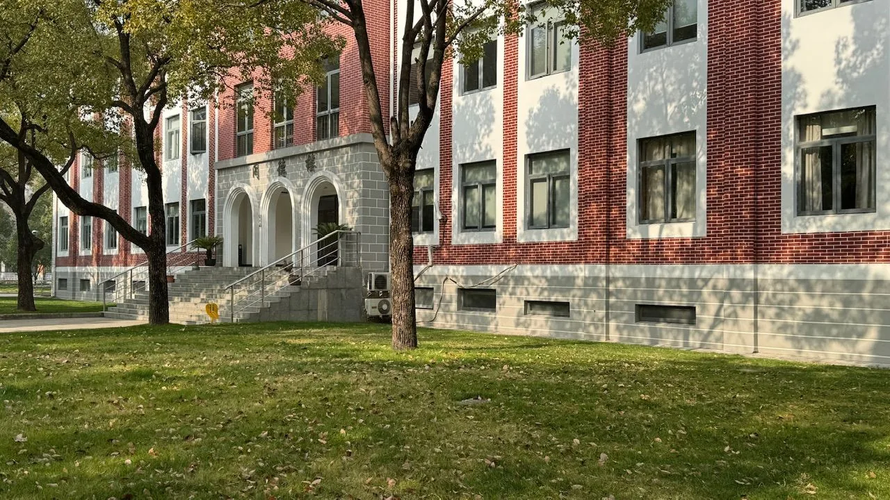
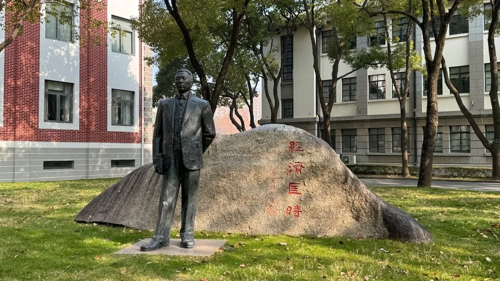
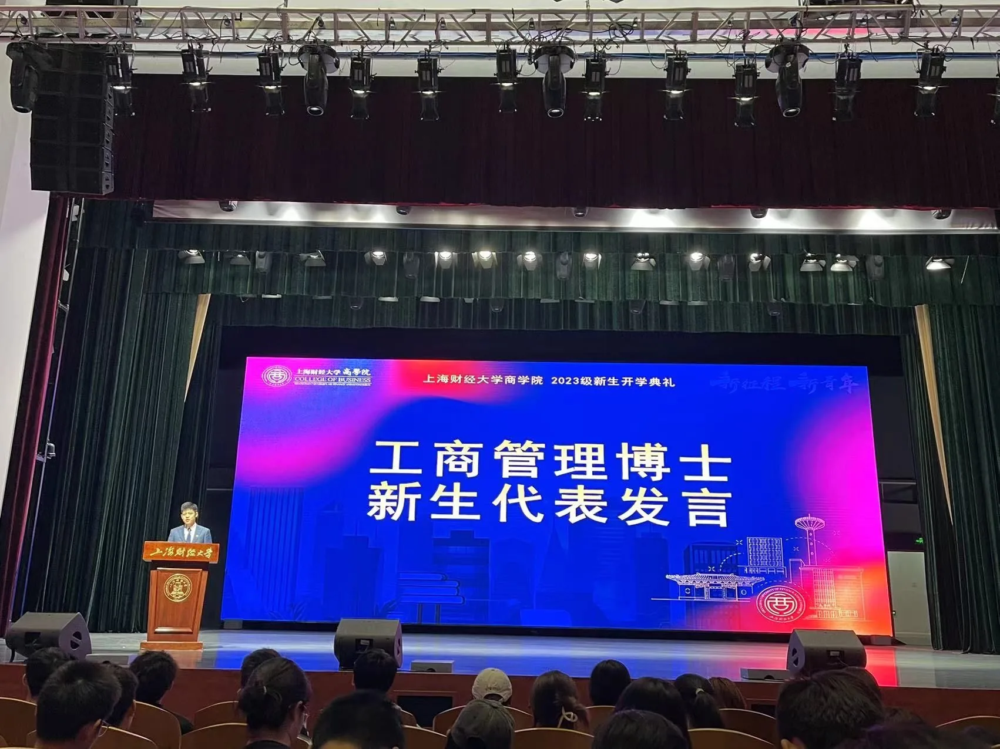

今天起晚了，没有按时上课，到了学校以后想着反正都迟到了，那不如逛逛学校算了，等着下课课间再溜进去，也算是“偷得浮生半日闲”。

上海的冬天还算是比较舒服的，不算太冷意味着可以不用缩头缩脑的走在户外享受阳光、也不会像广东一样连穿冬装的机会都没有。阳光带来的温暖和空调、暖气完全不一样，温度恰到好处不会那么霸道，从这个角度说人类还是属于自然的。

走到教学楼的这一段路我很熟悉，所以思绪不知不觉的开始回到过去的一年。这一年我经常觉得时间过得太慢，我觉得是因为事情太多而且没有一件容易的事情，处理过程耗费了太多的精力所以显得慢，老父亲却说我喝酒喝的太多。这套理论好比小时候无论是学习不好、视力下降、感冒发烧、打闹矛盾统统都能归咎于“电视看多了”，这一代人先入为主的思维习惯我已经习以为常了。

2023年终于过去了，好像我走了一段“送温暖下乡”还没到位的山路，尽管我知道一定会到，但过程的起伏波折太让人揪心，是我几十年的人生经历最丰富的一年。

- 二战博士终于上岸。第一次考博士没有成功原因很多：重视不够、信心不足、工作分神、生活分心、基础欠佳，甚至就连天气（2022年1月15日，阴）也是阴沉的很，当我得知我是倒数第二名面试的时候，我似乎已经知道了结果。最终分数出来的时候我还在听《深夜港湾》，这悲凉的气氛烘托的差点把我给送走。直到现在我听这首歌还会觉得无比悲凉。二战考试我准备了整整九个月，特别是准备初试的时候我还首阳，发烧39度的那段时间，每天晚上准备复习都到一点左右，我也不知道不怕死的原因是什么，到底是博士对我真的重要，还是要证明自己，还是摆脱了那些心魔的束缚报复那些曾经的命运。总之我挺了过来，初试很顺利过关；面试的时候也是准备充分，我把研究计划改了七稿，我把所有我自己可以考虑到的问题都研究了很多遍，特别是专业内容所涉及的基础数学也都过了一遍，自以为没有什么问题可以难倒我。面试的时候专业问题如我所料并没有什么卡壳，但临结束的一个时政问题让我语塞，我记得问题是：你怎么看待二十大报告提出的中国式创新核心？或者说你认为什么才是中国式创新的核心？我心里咯噔一下顿时有了“天要亡我”的感觉，谁能想到面试还要考二十大的东西？那也不能说不知道不是？我东拉西扯了大概五分钟，提问的教授实在看不下去了笑着说：“你记好了，中国式创新的核心在于坚持中国共产党的领导！”最终顺利拿到录取通知书，开学的时候老师还让我代表博士新生发言，由衷感谢老师认可。

- 高级职称成功拿下。其实这个职称耽误了很久，大概2017年的时候我就准备申请了，但因为各种各样的原因一直没能如愿。2023心无旁骛正适合攻克这种麻烦的东西。不出意外的，考试过程中我二阳了，好像病毒知道我每次热火朝天的做什么事的时候都会过来凑热闹，可能是看了《亮剑》里楚云飞的片段：“不管今天是谁在打平安县城，我358团一定帮帮场子！”新冠这个358团，我真特么谢谢你！最后的结果还是很好，顺利拿到证书，了却了一桩心愿。
- 投资生涯惨遭败绩。全年还没有过一半时间，就遇到了一件大事，大到我觉得甚至可以称之为人生的至暗时刻。人这一生不经历大的波折，对人的成长绝对没有好处。自开始投资以来，损失最大的一次就是15年牛市股灾，巨亏3万，所以一直有种盲目自信“我多聪明？市场敏感度多高？我怎么会判断失误？我怎么会被套路？”就是这种盲目自信造成了迄今为止最刻骨铭心的巨额亏损。有多巨额？单论损失比例，中途岛海战的日本海军尚不及此。这次投资失败有两个因素让我一时无法接受：1.使我开始怀疑前面的成功率完全是因为市场机会，也就是说我就是那只飞在风口上的猪；2.投资过程中后期已经丧失了理智，甚至有人说我当时的投资策略已经很恐怖了。失去理智太可怕了。这件事情整个过程仅仅9天，但我复盘后却不太记得起这九天发生的所有细节，就像被人下了蛊、着了魔。我还记得平盘的那天晚上，面对投资纪录的巨额损失时大脑一片空白，甚至以为这是一个梦，一切都归零了。当年山本五十六挟带全日本海军精锐士气高昂的准备与太平洋舰队决战时，他绝对想不到3天以后，日本海军几乎全军覆没。我是体会到了这种感受，坦白说这种打击对任何人来说都是巨大的，特别是不仅仅只有财富的损失，更多的是对自己过往的怀疑。但人生还得继续，我也还有很多的责任，总不能一蹶不振，最终还是靠自己一点一点走出来，我也是挺佩服自己这一点，不管什么困难，我都是靠自己走出来，无一例外。
- 工作理念大相径庭。投资失败的事件大概一个月以后，我也慢慢走了出来，开始调整自己的生活状态，也要把之前耗费的精力从其他地方慢慢转移到工作上来，这时候工作上发生了一系列很无语的事情。可能是之前投资失败的缘故，面对一些我不确定的事情时我首先怀疑的是自己而不是先甄别这件事情。基于此，我每天都在怀疑自己与怀疑事件的徘徊中度过，由此产生的内耗让我非常累。就这样我在努力推动工作时怀疑这件事的真实意义与怀疑自己时无条件服从上级指令的纠结中我第一次觉得不知所措。大概两个月之后，我不想在这么纠结，花了很多时间与精力真正去了解这项工作的实质，我确定这项工作没有实际意义，于是跟主要领导出现了经营理念上的偏差。经营理念上的偏差其实是个很要命的事情：苏联大清洗不正是这种情况吗？虽然企业的经营理念分歧不至于这么严重的后果，但整体氛围也总是不好的，直到四个月后监管部门直接出面支持我制止这项工作才终结了这一闹剧。人啊，一定要多读书！

不知不觉走到了不熟悉的地方，我平时很少逛校园，不比大学时就连哪棵树下几颗野草我都清清楚楚，一来现在上学时间太紧张，每次开车来也匆匆去也匆匆；二来也少了大学事情陪我逛校园的那些人。就这样经常睹物思人一定是老了的结果。怎么判断老了？四大法则：看书越来越远、尿尿越来越近、眼前事想不起来、过去事日益清晰。还好对比一下我只有最后一个符合，起码从男厕那句名言“向前一小步，文明一大步”的角度评价，我算半个文明人。为什么半个？因为前面总有野蛮人让我没法像前半步。

还有几件23年年底的事情持续到24年甚至更久的事情，需要或者说很值得花一番功夫的：

- 投资是仍然需要做的，可是需要很小心了，一方面是因为去年投资伤了元气，再也不能像以前一样肆无忌惮了，另一方面，现在情况真的不太乐观。今年不仅需要更加小心，而且风险敞口需要严格控制，商品可以停一停、债券可以投一投、股票可以等一等，学费不能白交，人生不能重来。
- 五个非金融投资需要花精力好好谋划一下，铺底的稳定现金流非常重要，目前看有三个是大概率可以落地，但能不能成为稳定现金流现在不太清楚，走一步看一步。
- 顶刊论文今年应该可以发表出来了，毕业大论文今年三月份可以开始启动，如果一切顺利，大概一年可以完成，争取3年毕业。
- 去年欠下了很多的学习、读书计划，今年要补起来，特别是基础类的内容要不打折扣的完成，否则以后时间和精力会越来越不够用了。
- 锻炼保养好身体，年纪越来越大，像过去一样的作息时间慢慢无法支撑高强度的工作了。

要说2024年的愿望，其实没有太多，就祝愿中国平安、家人平安、自己平安。
