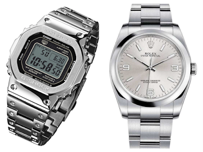

Casio2018年发布了多款新表，其实我很久没有关注过电子表了，大概至少20年了。受惠于互联网的发达，往往新闻不是你主动关注来的，而是app推送给你的。就这样，35年Casio纪念新表入了我的法眼。

我挺喜欢手表，这可能是遗传，我爸爸第一份工作就和手表有关，我也有过很多块手表，有奶奶给的、爸妈给的、自己买的，想把以前有过的手表都一一展示出来，但很久以前的手表现在连残骸都没了，只能留在记忆中了。   
第一块计时工具其实不是手表，而是一块怀表，大概5岁得到的。说真的我已经记不清那块表的样子，但那是我人生中拥有的第一块表，整天放在口袋里到处招摇，结果不到一周它就夭折了，可能也是质量不好。

第二块计时工具是外公给我的一个“猫头鹰”电子挂表，那个年代比较讲究多功能，我挑了一个可以计时、倒计时、显示日期的挂表，最牛叉的功能是它带了一个铅笔刨，我现在也不知道为什么会带这么个玩意儿。也许发明这个挂表的人觉得这个计时器就是考试用的，万一你看了时间心里一紧张铅笔写断了怎么办？这时候铅笔刨就派上用场了……

第三块表是真正意义上的手表了，可以戴在手腕上的。那是二年级的时候爸爸带我去买《十万个为什么》的路上15块RMB给我买的，一个可以打开盖子的淡蓝色电子表，最牛的功能是它带有到点提醒音功能。这块表最大的功能就是每次下课滴滴滴想起来提醒同学们：跟隔壁班干去！

第四块表是我最喜欢的了，是爸爸带我买家庭音响的路上花了140块RMB买的（大概算是社会平均工资的1/3），表盘带有温度变色功能的石英表，虽然这个变色功能没有什么使用价值，但是你可以想象一个装逼犯带了一个带有装逼变色功能的表，那得得瑟到什么样？！这个表带给我的使用价值超过了迄今为止所有的手表，因为那时候我对时间的认知意义远远超过所有时候——为了在爸妈下班到家之前在游戏机室度过每一秒欢乐的时光！！！以至于后来电池没电了我还花了我打游戏的特别预算里的3块5毛钱换了个纽扣电池，但可惜的是，爸妈有一次“清剿”打游戏装备行动中，它光荣的牺牲了，很感谢它教会了我时间观念。

第五块表是大学的时候买的人生中第一块全自动机械表，Citizen品牌，最喜欢它背后的全透玻璃设计，正面蓝宝石水晶玻璃直到最后也没有一点点伤痕，日期单历。它陪伴了我10年，从大学到第一次跳槽，鉴证了我的青春。前年的时候可能是因为太久了，它实在走不动了，至今很好的躺在我的抽屉里，无论什么时候在那儿都会有它的位置。（这块表已经停产，无图了）

第六块手表是托人从英国买来的Rolex，也是人生第一块Rolex。因为工作的原因，适当的需要一块能够适应较多场合的手表，也没有太张扬的那种，就它最合适。要说质量，Rolex绝对算顶级的，无论硬件做工还是走时精确度，没有能够挑剔的地方。虽然没有精确测量过，大概估计这块表的走时误差大概在±15／月，可是这表有一个不太好，就是平时戴的实在太小心翼翼，这就带来个问题——剧烈运动的时候没有合适的手表。

本来想试试手环，既能计时也能记录运动状态，但是手环两个问题：充电太麻烦、防水性能不好；后来看了看iwatch series3，也是有两个问题：续航力太差、依然不适合剧烈运动；然后又转移至Seiko小绿龟，价格也合适、性能也可以，但是体积实在太大了，造成非运动状态时太傻了，像个大头儿子一样……看来看去都觉得不合适，这时候app推送了Casio GMW B5000D新款发布，觉得一切都挺合适，在还是预定阶段的时候入手了一块白色金属版。

主要看上它一如既往的耐操属性：200米防水、10米防震、太阳能电力供应、6波段对时、世界时间……再加上精钢外观，即使参加一些工作场合，不注意也看不出来这是块电子表，感觉相当不错。就是价格有点不值电子表，感觉用今年的物价买了一个十年前的技术，但这毕竟是35年纪念款，也算Casio35年技术之大成的体现。更好玩的是老爸说35年前他也有一块这样的表，我听到太震惊了，这不就是Casio刚发布第一代GW B5000的时代吗？！
爸爸云淡风轻的说：“我曾经也有一块”。
