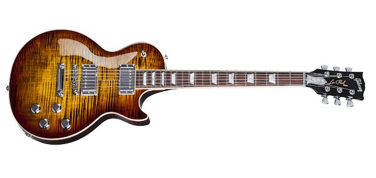
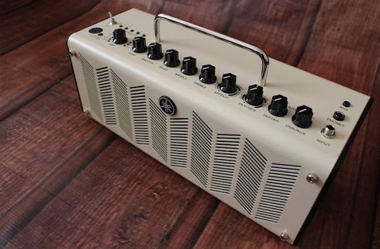

已经很久没有更新博客了，妈妈说你得继续把这个习惯保持下去，以后翻翻自己写的文章很有意思。我倒也不是不想写，只是实在写不出来了，最重要的原因是现在很少有感慨的时候，没有那么多心情去多愁善感，也没有那么多小文艺青年的百般思绪。

曾经的一把吉他已经完成了它陪伴我的使命，在闲鱼上顺利出售，虽然感觉卖亏了，但是买家是个很喜欢它的“同道中人”，只要能好好对待，我也就释然了。在出售之后总觉得需要再上位一个新的陪伴我，这是我一直以来喜欢的玩具，不一定有时间玩，可是能够在不经意间看看这美丽的花纹也是相当不错的感觉。就像爸爸说的：“现在跟你在一起的时间越来越少，即使你在我旁边不说话，我也觉得安心。”我想大概就是这样的心情。

新的吉他我选了很久，毕竟我想这可能是我买的最后一把电吉他了，看过Fender、P.R.S、Dean等等，以前喜欢的品牌现在看起来总有这样那样的问题，有些是音色问题、有些是款式问题。现在喜欢的点在于不那么夸张、张扬的音色和款式，当然颜色也不能太古板。最后挑来挑去就是这个Gibson 2017 Standard虎皮纹：

想起来原来的音箱也有点旧了，因为很久没有关注硬件的资讯，只是随便在网上搜索了一下看上了这个Yamaha THR10，我倒是也有朋友买过这个，听说还不错。

等了大概10来天后，所有装备到位赶紧试了试曾经意气风发的音色，听到温暖的音色后感觉太值了。更要比以前很喜欢的Fender和Yamaha好得多，果然上了年纪什么都喜欢醇的感觉，就连失真度也只能接受75%以下范围的。本想录一段试音音色上来作为小样，但是年久不练，手速已经跟不上音感了，实在不忍玷污装备和耳朵，于是作罢。

写到这儿，就像记了个流水账，果然写文章就像XXX，如果你不想千万别勉强，不然出来的结果惨不忍睹。

就这样吧，晚安。
