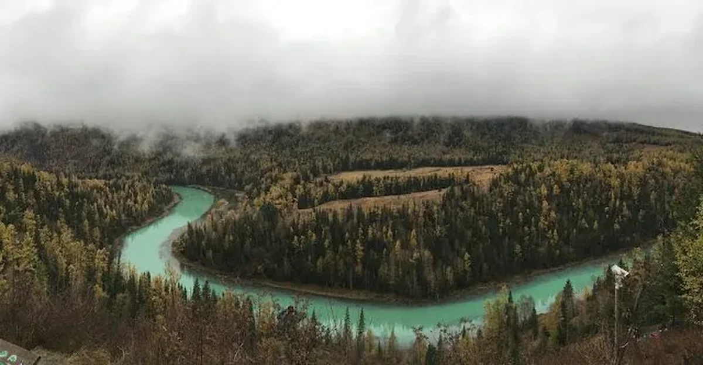
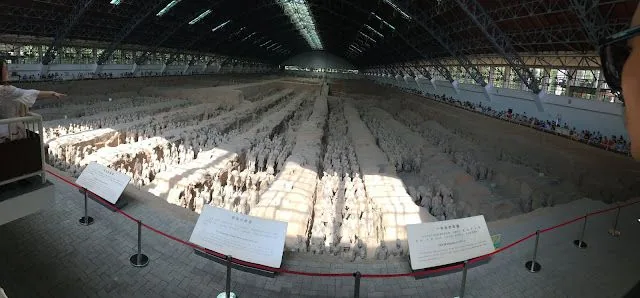
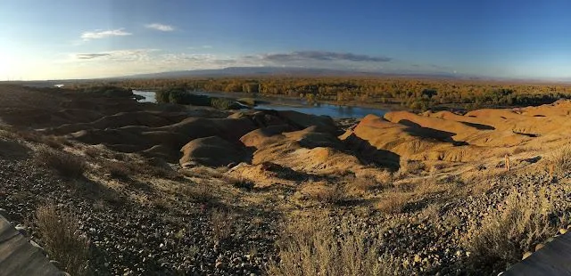
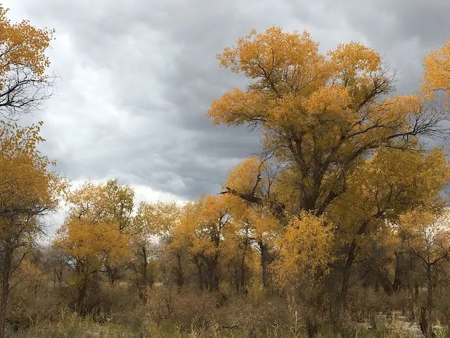

每年的假期总是给人不一样的感受，譬如去年的五一在南方享受湿润的微风，今年的五一就在北方回味湿润的微风。回忆中风的味道还是一样的，只是心里的有了不一样的思念，就像小时候吃过的糖葫芦，现在吃起来还是一样的甜，但满足我需求的程度是逐年下降的——边际效用递减。

人像是一个沙漏，所有的一切都会随着时间慢慢流逝掉，不管是人的生命、精力、体力还是对其他的爱好、需求和感情，不论这个沙漏的质量有多好，也不管漏的多慢，只要是正常的人，这一点总是不会错的。放假的时间难得可以在家好好想想这一年来的得失，算是人生的旅途中难得的休整，卸下了不必要的、恢复了精力准备更好的踏上后续的征程。

这一年跑了很多地方，有个人出游、有工作出差、也有求学经历，回来看看app中一年旅途经历的地点也是一种对过去的回忆。领略了2017年第一次雪景，也享受过南方水乡的家常菜，每一次旅途的出镜都会看到那熟悉的微笑，也不知道那是不是真的微笑，又或者以后看到这样的微笑是否还觉得由衷。只是这些出镜片段除了偶尔想起来的时候谁也看不到，算是包扎过的伤口不能见风。

不知不觉都这般岁数，写出来的东西还是这么矫情，其实这是很恶心的一件事情：这真的是你的所思所想，可是看到跃然于纸上的东西仍然一阵阵作呕。好比宿醉后的呕吐，完全憋不住，但看到吐出的污秽物促使你一阵阵的吐，以此往复，直到再也吐不出来为止沉沉睡去……说到醉，从来没有什么场景比这更加真诚了，你越是想忍缺怎么也忍不住，那么吐出来的即是现实，所以真诚与现实也就是吐不吐的区别，真诚与现实说到底也就是一口的距离，真诚也就是一地污秽之物而已。只是没吐出来的时候是自己优中选优吞下的精华。

想起去年十月在喀纳斯的经历，没去之前脑袋里想像出来的仙境离喀纳斯湖都可能还有一个改革开放三十年的距离，什么美好的风景都想象过。在长途跋涉近40小时之后在大雪封山之前终于赶到了传说中的喀纳斯湖，不可否认的确有独到之处，西域风景和中原毕竟有不同的地方，但要说颠簸40小时来到这儿似乎性价比又不太高：一方面的确来这儿的旅客之前没有见过，另一方面受骗的人除非损失可以挽回否则谁会坦诚自己被骗？很多事情往往都是这样，在你没有充分接触它之前，你的幻想和期望几乎都是战胜客观实在给你的真实反馈，而真正了解之后又觉得与自己的期望差距过大，这时候矛盾心理一定会占据对这件事的所有期盼，就像沙漏一样慢慢的期望与需求就会消耗殆尽。

去年玩过两个传说中的风景都是这样：喀纳斯和兵马俑。你看过很多介绍、听过很多赞美，等真正看到之后发现太言过其实：

不过往往你在意的让你失望，不经意间会给你意想不到的惊喜，在喀纳斯的归途中路过的五彩滩和胡杨林我觉得很漂亮，虽然不出名可是我觉得这风景我能呆呆的看上一整天。特别是五彩滩每一个瞬间因为阳光入射角度不同都会觉得有不同的色彩；而胡杨林更有萧瑟的美感，天地自成一色，天地之中的黄色树叶是那天地中仅存的一丝生命，让人感慨万千。

关于真诚和现实，其实谁都没有错，非要论错的话那么仅在于那一个瞬间你要的是心里的期盼还是眼里的风景。

谨记这一年来的生活。
