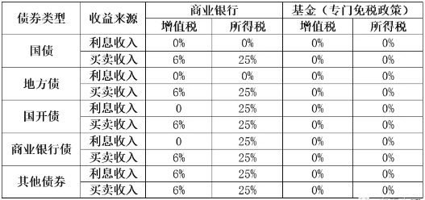

在前面我们提到过，在计算信用利差时，因为国债有税收优势，因此无风险利率选取的都是国开债利率。而国开债和国债同为无风险债券，在刨除掉违约风险之后，两者之所以会出现利差就是因为税收差异（国债25%的税收优惠）和流动性性差异（国开债流动性较好），其中税收差异是主要原因。

## 隐含税率：理论值 25%

从税收角度来看，由于国债利息收入免征企业所得税（对应 25% 的税率），在不考虑其他因素的前提下，隐含税率（1-国债收益率÷国开债收益率 ）应该稳定在25%的水平。但是由于以下几点原因，隐含税率往往会低于25%的水平。

## 为什么实际低于 25%

一来公募基金和境外机构在持债时享有免税优惠，所以它们会偏好于持有票息更高的国开债。二来从流动性角度上来看，由于国开债的流动性会略好于国债，市场会给予国开债一部分额外的流动性溢价。三来由于免税是只针对利息收入，这意味着如果投资者更看重的是债券买卖收入那么免税政策的影响并没有那么明显。

## 利差与债市走势

回顾过去几年间债券市场走势与隐含税率之间的关系，我们会发现国开债国债利差与债市市场走势有着明显的正相关。这与国开债和国债在投资者结构，流动性溢价等多方面因素有关。由于国债的免税优势，银行等配置盘往往更愿意持有国债，截止2020年11月，有78.6%的政府债券是由商业银行持有；而广义基金等偏交易盘的投资者往往会更偏好流动性较好的政策性银行债，截止2020年1月，广义基金持有超30%的政策性银行债。那么在牛市的时候，交易盘往往会通过加杠杆等方式来买入国开债，推动国开债收益率快速走低，国开债与国债的利差也随之收窄；而在熊市的时候，非银机构由于前期加杠杆，以及资金来源于银行，其对市场资金面的波动会更加敏感，它们会更快的抛售流动性较好的国开债回笼资金，这就推动了国开债收益率走高，利差也随之走阔。

另外，隐含税率的波动也和期限利差一样会在上有顶，下有底的区间内波动，这就使得隐含税率会有回归均值的特性，比如当国开债利差接近历史高位后，往往会开始向下调整，反之则会有向上调整的趋势。我们也能通过这一趋势，来把握投资机会。

