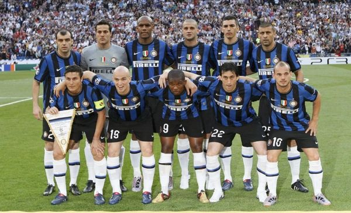
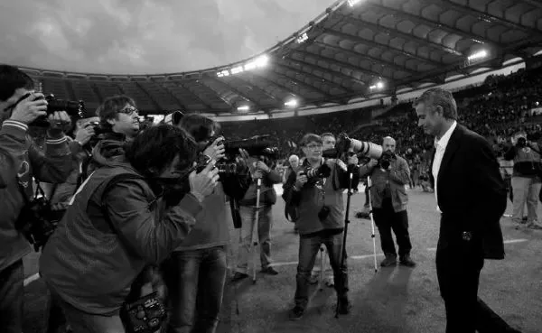
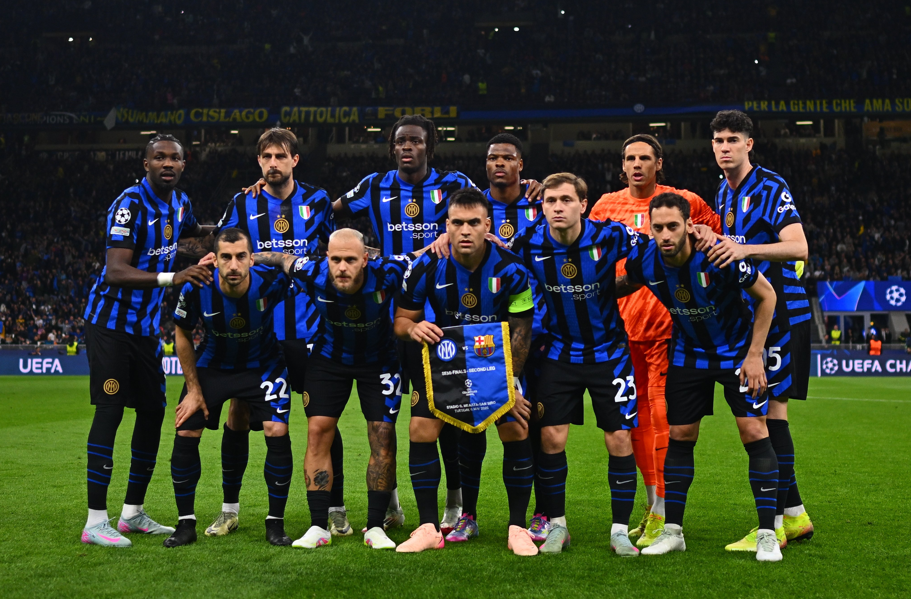
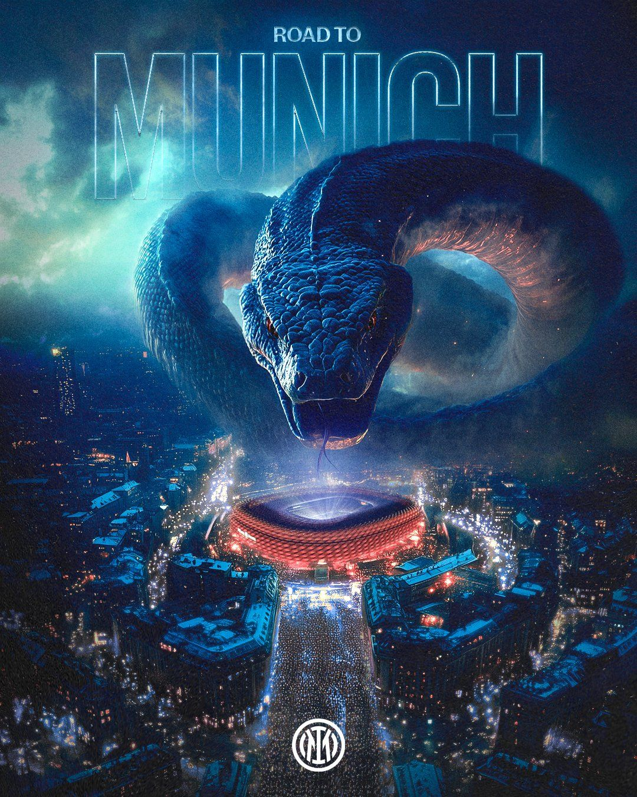

今天凌晨的比赛因为最近太累没有起来看，毕竟年纪大了熬夜熬不动了，早晨醒来的时候发现手机推送4-3淘汰巴萨，我就知道我错过了。

虽然我没有看直播，但是喜欢国米的心一如既往的没有改变。我甚至清楚的知道现在这支国米的每位球员的历史、年龄、优势脚，但唯独不知道这只年老力衰的国米居然再一次挺进了决赛，这让我想起09-10赛季的那支“五冠王”。

当年的那只国米也是不被任何人看好，因为在小组赛阶段磕磕绊绊的才进了淘汰赛，虽然没有这只国米的年龄大，但也是过气球星+没名气的球员组合：埃托奥是伊布拉希莫维奇的添头、米利托是热那亚的大龄前锋、斯内德皇马弃将、卢西奥也是拜仁淘来的，平均年龄29岁多，是当年欧冠平均年龄最大的一支球队。

但就是这样的队伍，精神属性发挥到了极致：克莫斯科中央陆军、过切尔西、斩巴萨、胜拜仁，每一支球队都是其所在联赛的冠军，堪称历史上含金量最高的一届欧冠冠军。为什么可以赢下？那是因为精神力量。

埃托奥忿忿不平自己为什么没有真正的平台，被皇马青训抛弃辗转多年到了巴萨以为得遇明主，但还是被当作伊布拉希莫维奇的添头转会来了国米，当然需要向世人证明自己才是那个一流前锋；斯内德顶着皇马“核心”的名号迟迟没有打出应有的身价，被皇马以耻辱的1500万欧元价格转会到国米，他理所应当向欧洲证明自己的实力毋庸置疑，只是体系匹配度的问题；卢西奥从拜仁过来，很明显拜仁觉得卢西奥配不上拜仁的实力，谁承想决赛卢西奥面对的就是老东家，更是会拼尽全力证明自己；萨内蒂，如今的国米副主席，在国米任劳任怨近20载，唯一遗憾的就是没有收获大耳朵杯，在那一年天时地利人和的时候难道不需要圆自己一个欧冠梦吗？最后就是主教练穆里尼奥，如今的他虽然远在土耳其超级联赛，但当年入主国米时，他身披葡超波尔图联赛冠军、欧冠冠军，切尔西英超冠军的战绩来的，当他被切尔西解雇时，他需要一个机会向英超、切尔西、向那些所有不看好自己对自己有着莫名敌意的人看：他依然是最特别的那一个！就这样，09-10赛季那支大龄国米义无反顾地踏上了欧冠的征战之路。

过程不必多说，我认为是足坛历史上最励志的一次征战历程，我清楚的记得在2月的莫斯科寒风凛冽、冬雨连绵，中央陆军竞技场是否还记得当年拿破仑和德意志第三帝国也曾败于这恶劣的天气？1/8淘汰赛对阵切尔西，埃托奥那全场唯一进球为穆里尼奥被阿布扫地出门出了一口恶气；客场3-1胜巴萨，主场0-2负于巴萨，在客场净胜球制还在的那个赛季，巴萨影帝布斯克茨的奥斯卡最佳男主角小金人奖杯依然无法洞穿国米的铜墙铁壁；决赛在伯纳乌，所有国米将士众志成城面对久违的欧冠决赛，厉兵秣马多年为的就是身披甲胄为了自身荣誉而战的光辉时刻，那一夜卢西奥没有退路、穆里尼奥没有退路、国米更是没有退路。

决赛米利托的两粒进球将拜仁送回了德甲，也将国米送上了欧洲之巅，圆了莫拉蒂16亿欧元的欧冠梦，也成就了穆里尼奥世界级名帅的历史地位。那晚伯纳乌的灯光将蓝黑战袍映射出了60年前的光彩，莫拉蒂多年的投入终究换来了无价的回报。所有人都一样，在梦想达成的那一刻都会陷入迷茫，未来的目标在哪里？又该何去何从？

穆里尼奥选择了伯纳乌、国米迎来了贝尼特斯，从巅峰滑向深渊的时候唯一不需要考虑的就是滑落的速度。自此之后十年，国米经历了3次易主、12次换帅、每个赛季但凡能租到一个还有名气的球员就算这个转会季有收获。这么黑暗的经历终于等到了张康阳任主席、马罗塔任经理、因扎吉任主帅的“小巅峰”。

现在的国米不能说已经恢复了，只是比那个暗无天日的十年好了不少，起码不再被财政公平法案束缚、不再考虑巨额贷款怎么偿还、明天还能不能见到今天赛场上的主教练……但球员老化的问题依然没有解决，甚至比09-10赛季的国米还要老上一岁多，在今天老龄化严重的中国，怕不是找个养老院拎11个老头估计年龄也就这样了。但是，这就是足球的魅力所在，就如同人生一样：你没有有钱的股东，就好比你不是个富二代；你没有自己的球场，就好像你现在还在租房；你不是巴萨那样的会员制，就好比你没有优秀的家族支持。这是绝大多数普通人、平凡人的开局条件，但是你不能因为这些而自怨自艾，你要找出你有的一切：你有众志成城的斗志、也有团结一致的氛围、还有枕戈待旦的准备、更有决胜一切的勇气。到了决赛的时候，资本、球星、名气什么都不重要了，能到这个地步的对手都不是仅凭运气就可以同场竞技的，双方血红的眼睛里除了荣耀一切皆是虚无。

今年的国米已经初具冠军相了，它有着09-10赛季那支五冠王所有的特质，这只国米的所有人包括37岁的阿切尔比、36岁的索默、36岁的姆希塔良、35岁的达米安、33岁的德弗莱、31岁的恰尔汗奥卢……他们这一届欧冠以后还能不能在赛场上看到都是个问题，更何谈再为欧冠而努力呢？当年的那支国米赢了英超、西甲、德甲的冠军，这一届也差不多，先后淘汰拜仁、巴萨，这么来看巴黎圣日尔曼与阿森纳的半决赛，阿森纳的胜率要大很多。那一年对战拜仁在伯纳乌，如果这一届一切顺利，那么就会与英超的阿森纳相遇拜仁的安联球场。不管冠军是不是国米，我觉得作为国米的球迷已经不能奢望更多，无论结果如何，这支国米都是每一个内拉祖里心中的那个冠军。

2025年6月1日，灵蛇天降安联球场！
