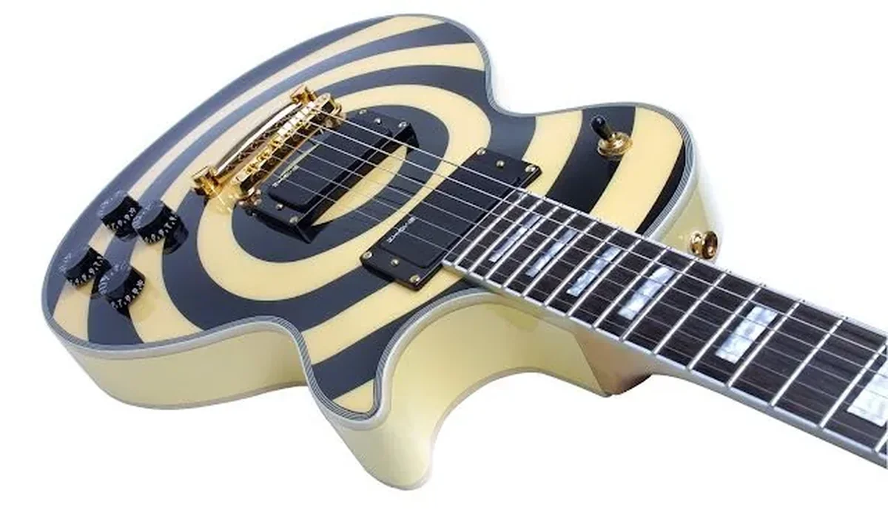
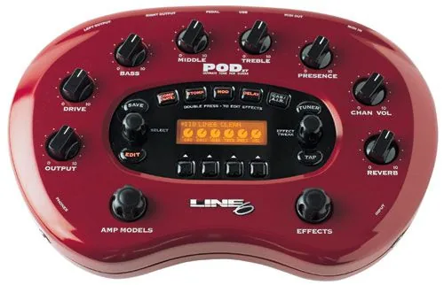
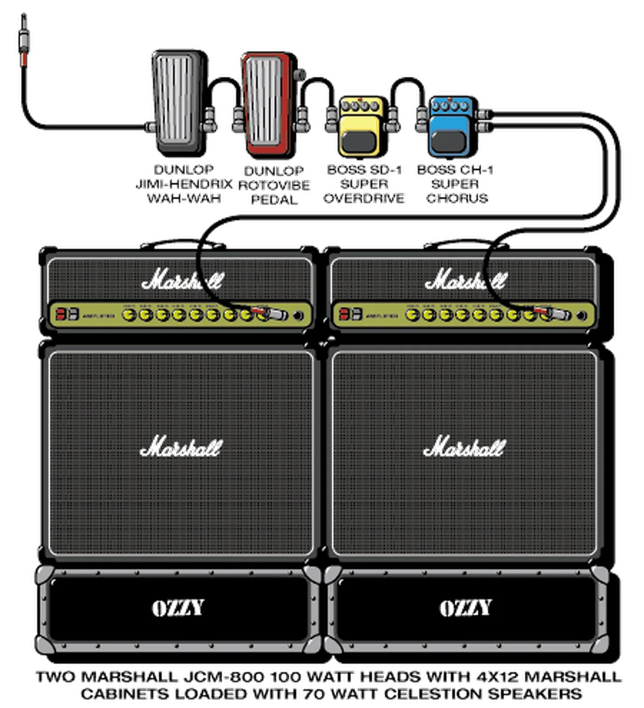

刚出去倒水的时候不小心把立着的吉他给碰到了，琴箱“嘭”的一声砸到了地板上，我没有马上看看木地板有没有被砸裂，而是心疼的打开琴箱看看吉他有没有问题，还好，目前看来没有什么问题。

这是我的第三把吉他。第一把吉他是我在大学的时候买的，那是一把红色的Squire，是第一批在中国大陆销售的，虽然价格不贵，但是第一批的用料非常好，我靠着那把琴在大学“打下一片江山”，意义非凡。不过在大四的时候，因为琴颈好像有点弯，而且琴身也被我磕了几次，有伤痕了，我把它卖给了跟我学琴的一个学生。但卖了之后我就后悔了，因为那孩子根本不会弹琴，并不是我没教好，而是他实在不用功，我想那把琴在它的手里想必不会受到很好的关怀。但毕竟已经卖出去了，我也就没再开口要回来。

第二把吉他是我工作后没多久买的，是把练习琴，没有多少故事可说。主要就是为了太生疏而练练手的。那时候刚大学毕业，也没有什么认识的朋友一起玩，就纯粹的自娱自乐而已了。

过了大概半年时间，以前的同学偶然联系了我，问我现在还玩不玩吉他了，我说玩啊。他们那时候正好也在玩乐队，两方一拍即合，我尤其激动，马上拿着工作后的所有积蓄置办了装备。虽然那时候没什么钱，还问爸爸借了钱，但还是买了我认为比较好的设备，就为了等我的那些朋友从远方归来。后来才发现音乐爱好这东西完全没有粮食和衣服来的实在，饱暖了之后才能想起还有音乐这样的理想。

第三把就是现在的这把Zakk Wylde签名款，我很喜欢Zakk那种狂野的布鲁斯风格所以就爱屋及乌了。这琴说起来还比较命途多舛。第一次付款后等了大概三个月，一直说没货没货的，最终我实在不耐烦了，跟老板发怒了：“一周内见不到琴，你就退款+利息吧！”果然威慑的力量强大，一周后就收到了吉他，那天还是年前，我激动到简直就是连滚带爬的从公司跑到大门口，哪知道包装一拆开发现琴断成了两截。要不是年轻我估计当时立马就脑溢血死过去了，我心如死灰的跟老板说：“我再也不想听什么解释了，你赶紧把钱退给我吧，别忘了加同期银行存款利息！”那老板一听这消息，心也哇凉了，连连说打电话给物流确实，我听她惊慌失措的语气估计不是拿把坏琴忽悠我的。联系好物流后再三保证再寄把新的来，包运费还送一套进口弦。听老板这么有诚意我也就算了，但那时已经是年廿九了，没办法只能等到春节后了。估计过了10天，新的吉他过来了。

打开包装我就被震惊了，果然是Zakk爆炸力的风格，我经常幻想着如此爆炸力的声音在午夜时分响彻云霄的感觉，不过从来没试过。当时我想今晚无论如何得试一下，就这么惨绝人寰的念头被另一个现实击碎了——缺个效果器。
对于Zakk的音色我也爱不释手，在网上找了他的设备，但单块效果器组合太贵，而且效果局限性大，就只能考虑合成效果器了。本来挺喜欢Boss的，但一个朋友说你总不能到40岁还在重金属啊，我想那就转而Line6吧。其实40岁这东西还能不能用都不知道，想的太远了。我那时大概只有2500的预算，选来选去只有 Line6 POD XT能满足我的要求。

其实这不算个真正意义上的效果器，它是个音箱模拟器,拥有丰富多样的箱头设置，甚至连不同的话筒离音箱的距离、位置都能自由设置，理论上可以调出你想要的所有音色。我觉得这个比较符合我的要求——物美而价廉。就在设备全部到齐之后，外地的朋友们还是舍弃不了那边的工作，不能因为梦想而丢掉饭碗。最后只有两个朋友回来，因此也只能两三人一起凑着玩玩了。长大之后才发现，以前想象的那些美好，做出的那些承诺，在现实面前都会显得微不足道，最终决定你的说来就是那五斗米，你不折腰都不可能。
直到最近才发现，原来有些时候我们会那样无助和脆弱，经不起一点风雨。你的坚强和信仰很可能在一瞬间烟消云散，因为很多事情并非我们力所能及。在梦碎的瞬间，往昔的那些豪言壮语和些许诺言就像一个个看着你嘲讽的小丑所发出的零散笑声，一次次重击在我的心口，疼到说不出话。
另外，用上述装备怎么样都调不出Zakk的爆炸力音色，估计跟我的功力有关。好比功力高深的人草木皆为利器，到我这儿估计倚天剑也只能削铅笔了。

