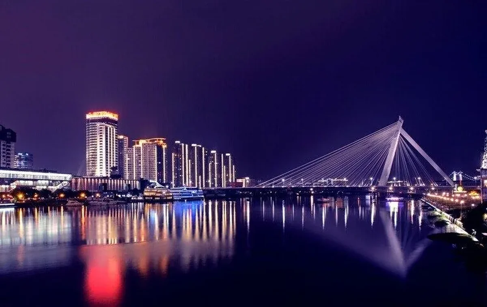
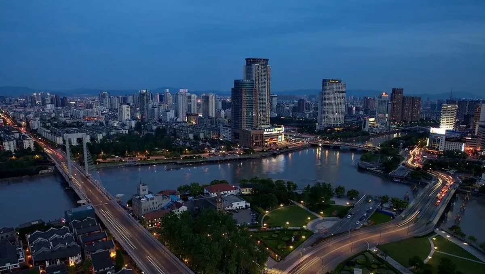
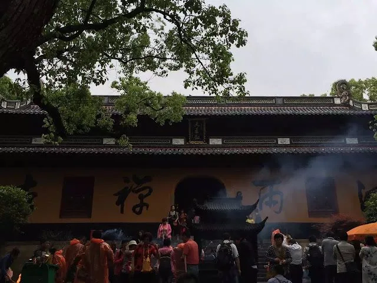
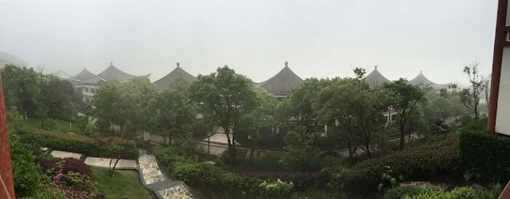
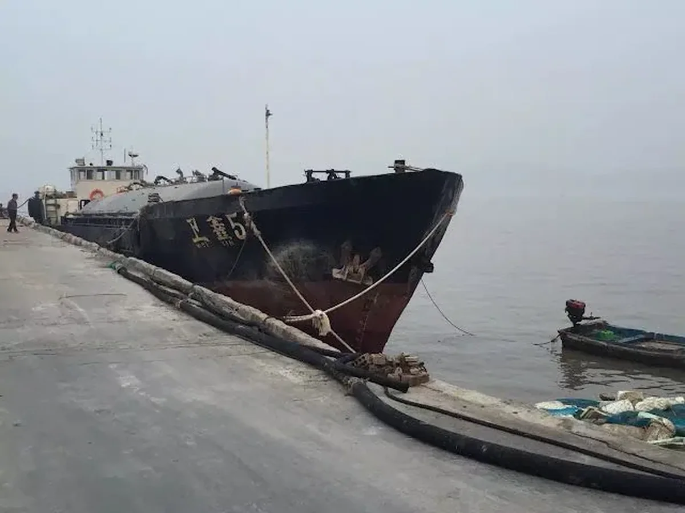
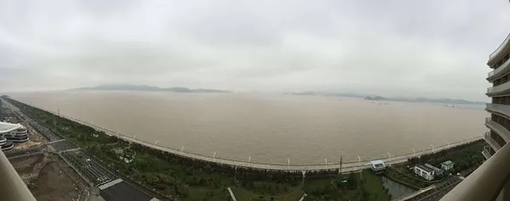

又到了该说再见的时候，我总想对这段时间做个总结、写点什么来纪念一下————这个我不熟悉却留下了我一年足迹的土地。

清楚的记得2016年3月25号，开着我心爱的小汽车，一路吃着火锅唱着歌来到宁波。印象中宁波这个全国为数不多的计划单列市被“港口贸易”、“民营经济”、“高度市场化”、“开放自由经济”的光环笼罩。我敢说绝大多数没有亲身生活在这里的人们都会有这样的印象。因为现在的人都很“理性”，凡事都得用数据说话：

- 宁波户籍人口783万；
- 经济总量排名全国16名达到8560亿元；
- 财政收入2145.7亿元；
- 更是被2016年媒体评为“新一线城市”，与杭州、南京等区域经济龙头伯仲之间
- ……

但理性的数据也有我们看不到的地方，那些才是这个城市真正的样子。

## 城市印象

还记得开车来刚下高速的时候，是一条很长的带隔音板的高架桥直通市区，那时候给我的印象就是挺压抑的城市；住下来之后其实这个城市的中心真的不算大，下图就是老城区的核心地带，你能看到多少，那大概就是核心区的大小：

### 城市历史

据说公元前2000年的夏朝就有区域概念，叫做“鄞”（其实这个字我也是来了之后才认识的）；唐长庆元年（821年）州治迁至三江口（今海曙区），并建子城；明洪武十四年（公元1381年），为避国号讳，朱元璋采纳鄞县读书人单仲友的建议，取“海定则波宁”之义，将明州府改称宁波府；1994年宁波被确定为副省级城市。

### 城市文化

这里说的文化不是学问的意思，而是这个城市的市民处事态度和习惯思路。刚到宁波我想当然认为宁波文化和杭州差不多，后来发现大错特错，因为最明显的饭菜口味和杭州就是很大不同：杭州清淡、宁波盐重。至于为什么文化会不同，我有我的理解，这就不多说了。

### 市容市貌

这个标题给的有点大，搞得我好像是市容办主任一样，但这一点却是每个游客或异乡客的第一印象，对我来说是能否对这个城市“一见钟情”的关键因素。很显然这儿很难让我喜欢，不是说这有多不好，而是没有好到让我喜欢。我在这儿一年一个月，除了上班、应酬、买东西、看电影、开会之外我从没有逛过街，包括被本地人引以为豪的奢侈品中心。

## 工作情况

我从来没有离监管这么近过，同一幢大楼：人行、银监、外管局，监管部门据我办公室的物理距离大概4至6层楼不等，往往一个电话通知要来调研、检查的时候，我电话还没挂断他们监管就到了，让我体会到什么是领导的关怀与温暖。

### 开放程度

用“小富即安”形容这个“新一线”城市再恰当不过了。这个城市的工作氛围实在不能算是一线城市的标准，甚至连二线城市也比不了。“少不入川”在宁波可以相当适用，所以这也是告别的理由之一，实在不想在太安逸的地方浪费生命，但你也不能说这是错的，因为如果我是个本地人我一样也会这么安逸的度过余生，谁想和安逸过不去？   
这个氛围带来的一个恶果就是固步自封——“自己现在拥有的就是最好的”，而类似于“走出去、引进来“的战略也仅仅停留在口头，所以同样的结果也在整个城市的发展过程中得到体现。我记得在2006、2007年，杭州人说起浙江经济无不叹服同属浙江副省级城市的宁波，但是短短十年过去，不论是城市发展理念、基础设施、区域带动能力还是城市影响力、人才吸引力都大大的超越宁波。这里面固然有城市定位的尴尬之处和被本地人诟病已久的前任市委书记问题，但宁波市民的理念决定了城市是否有发展潜力。邓公的话的确很有道理——”首先要解放思想“！

### 自由活力

这也是一个让我纠结了很久的点，不管是传统的古典经济学还是哈耶克的自由经济观点都试图说明市场经济往往更具活力，宁波这个以民营经济所主导的市场当然更是市场决定一切的地方。也许是太市场化缺乏了必要的管理导致经济行为偏离了预定轨道，这儿的监管比任何地方都要严格，严格到“法无允许即禁止”的地步。   
在来之前我就听说过这儿的不少案件，来了之后又发生了不少案件，所以行业监管特别严格也就不难理解了。只是这样的重压之下，“活力”、“创新”似乎就无从谈起。

### 工作之余

我到这儿应酬的次数远远没有之前多，一方面是之前太多、另一方面这儿确实不是个我喜欢应酬的地方。首先这以海鲜为主，在嘌呤临界点边缘的人绝对不会认为满是海鲜的宴席有多少吸引力；其次这儿基本喝红酒，等喝多了之后第二天醒来才知道红酒引发的痛就像是掏空身体的痛。不过也让我见识了不少喔连汉字都叫不上来的海鲜种类，以后我可以说“我没吃过海鲜，我还没见过吗？”

## 其它

宁波所属的区域其实不算小，在今年行政区划改革以前所辖范围为五区三县两市，其中除了宁海县和象山县之外所有区县都是全国百强县；听说舟山市早先也是宁波市辖范围，后来独立设地级市。

### 普陀山

记得这是2016年第一季度工作会议的会议地点，第一次逛了普陀山、第一次拜了南海观世音菩萨、第一次听了普陀山一位大师的讲话。最让我印象深刻的是那个大师的讲话，在我印象中中国的和尚除了吃斋念佛似乎不谙世事，但这个大师不仅与时俱进、还能继往开来，他的《论佛教的创新与挑战》真是让我嗔目结舌，原来和尚跟我们一样，除了遁入空门外他们的所学、所知、所想别无二致。

普陀山三大寺院之一：

普陀山上最好的酒店——雷迪森，这天正巧下点雨，有点雾蒙蒙的感觉还不错：

### 舟山群岛

季度工作会结束后到舟山的沈家门吃了地地道道的海鲜，还能看到渔民打渔的小船：

要不说海景房贵，就是黄不拉几的大海我就有种舒畅的感觉，晚上“惊涛拍岸”更像是催眠曲一样：

### 奉化溪口

宁波必去的一个地方应该是奉化溪口的蒋委员长老家，虽然民国时期到解放战争时期偶有政见不合，但委员长在民族大义面前却是毫不含糊；其子蒋经国先生也在推进台湾民主与地区发展问题上做出了不朽的贡献，理当致敬。   在蒋氏故居看到蒋经国先生画像旁的一副对子，也只有这样地位和身份的人才能用得上，不过我看后也很有感悟。虽然每个人在历史中所处的地位和承担的责任不同，但相同的是应该为国家、民族做出自己应尽的贡献，无论什么时候我觉得都应该以此自勉。

## 最后

初到甬城，我以为我会在这里待上三五年，甚至有可能会在这里定居。只是这个世界变化太快，你永远不知道明天醒来你会在哪里、你会遇见谁，300多天的时间我还没有体会到真正宁波的味道、还没有走完朋友们向我推荐的大街小巷、还没有真正感受到这座城市。

老实说，对宁波我虽然没有太多的喜欢，这却是我离开家乡的第一个驿站，不管好与不好总是值得纪念的。这座古老的城市以她自己的方式继续着属于自己的轨迹，我一样会在下一个城市接受岁月的历炼，希望下一次再回来与这里重逢的时候能看到完全不同于过去的彼此。

今夜，我们互道珍重————宁静江水穿流而过的宁波！
