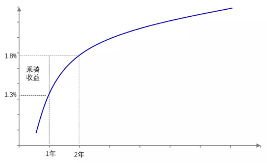

在了解收益率曲线后，我们会好奇收益率曲线对我们投资会有什么帮助呢？接下来我们分析，基于收益率曲线的几种投资策略。

## 骑乘策略

骑乘策略的基本思想是在短端收益率低于长端收益率时，假设预期收益率曲线在投资期内形态不变，那么随着时间的流逝，期限变短的债券到期收益率也会随之降低，这会给债券投资者带来额外的资本利得收入。

为了更好的理解骑乘策略，我们举个例子。假设1年期和2年期零息国债的到期收益率为1.3%和1.8%，这时如果投资者买入一张2年期零息国债，买入价格为100÷(1+1.8%)^2=96.49元，即如果投资者持有到期，那么他能够获得1.8%的收益。

持有1年后，这张债券的剩余期限为1年，假设1年期的收益率还是1.3%，那么投资者可以按照100÷1.013=98.72元的价格卖出该债券。

而在这一年里，投资者获得的投资收益率为：98.72÷96.49=2.3%。其中1.8%是持有债券获得的收益，而0.5%[（1.8%-1.3%）×1=0.5%]的收益是由于随着期限的临近，价格上涨带来的额外收益，这一部分收益也就是我们说的骑乘收益。

从上面的分析中，我们能发现有两种情况会比较适合使用骑乘策略：第一，债券收益率曲线比较陡峭，那么随着期限的降低，收益率下降的幅度更大，投资者也能够获得更高的骑乘收益；第二，剩余期限越长，投资者越能获得更高的收益。

不过获取骑乘收益的前提是未来收益率曲线不会出现明显的变化。如果1年后收益率曲线大幅上移，那么收益率的大幅上行导致的资本损失将会侵蚀骑乘带来的收益，如在上面的例子中，如果1年期收益率变为1.7%，那么骑乘策略带来的额外收益就只有0.1%了。

需要注意，上面是基于零息债券的测算，如果投资者持有附息债券，那么债券价格需要按各期现金流贴现计算获得，在计算骑乘策略时也会更加复杂。

以附息债券为例，假设市场上9年期和10年期资金的到期收益率分别为2.49%和2.54%，那么票息为2.54%的10年期债券市值=面值=100元， 票息为2.49%的9年期债券的市值=面值=100元。

假设未来到期收益率不变，那么投资者持有10年期债券1年后获得2.54元的票息，另外按照100.40元出售该债券$（2.54÷1.0249+2.54÷1.0249^2+...+2.54÷1.0249^8+102.54÷1.0249^9=100.40）$，那么投资者持有该债券获取的收益为(100.4+2.54)÷100-1=2.94%，其中骑乘收益率为0.4%。

从下表里我也能够看到6年期债券由于曲线最为陡峭（6年期和5年期的利差为0.32%），且剩余时间也较长，1年后6年期债券的骑乘收益能够达到1.6%，这极大的增厚了投资者的持债收益。

| 现在剩余期限 | 市场到期收益率 | 持有收益 | 近似骑乘收益 | 精确骑乘收益 | 近似总收益 | 精确总收益 |
|---|---|---|---|---|---|---|
| 2年 | 1.37% | 1.37% | 0.22% | 0.22% | 1.59% | 1.59% |
| 3年 | 1.44% | 1.44% | 0.14% | 0.14% | 1.58% | 1.58% |
| 4年 | 1.60% | 1.60% | 0.48% | 0.48% | 2.08% | 2.07% |
| 5年 | 1.79% | 1.79% | 0.76% | 0.37% | 2.55% | 2.52% |
| 6年 | 2.11% | 2.11% | 1.60% | 1.52% | 3.71% | 3.63% |
| 7年 | 2.36% | 2.36% | 1.50% | 1.40% | 3.83% | 3.76% |
| 8年 | 2.46% | 2.46% | 0.70% | 0.64% | 3.16% | 3.10% |
| 9年 | 2.49% | 2.49% | 0.24% | 0.22% | 2.73% | 2.71% |
| 10年 | 2.54% | 2.54% | 0.45% | 0.40% | 2.99% | 2.94% |

注：设一年后市场到期收益率不变；近似计算公式为：1年后剩余期限×（现在到期收益率-一年后到期收益率）；精确计算为现将一年后现金流按照一年后到期收益率折算出价格，其中价格变化带来的收益率为骑乘收益，利息收入为持有收益。）
