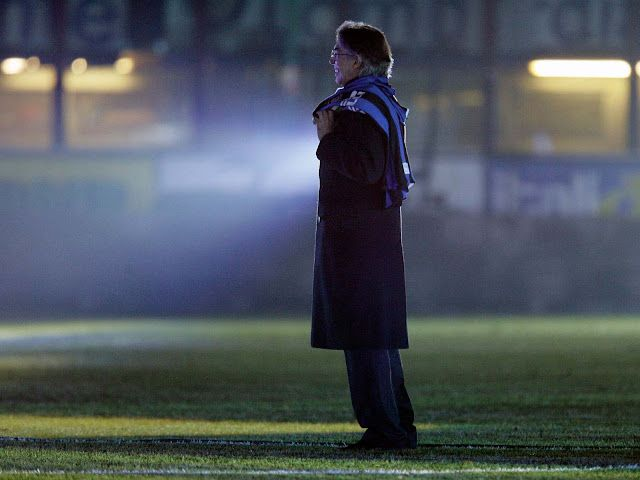

2011——2012赛季开始了新的征程，但国际米兰依然在混乱之中，0-1、4-3、0-0……你永远不知道加斯佩里尼的最后底线是什么，你也永远不知道马西莫·莫拉蒂的底牌是什么。

每一个热爱国际米兰或者热爱足球的人，都应该对马西莫·莫拉蒂充满敬意。在现在，你几乎不可能再找到一个出于热爱足球，进一步说是热爱国际米兰而不停付出的主席了。1995年购回国际米兰之后，莫拉蒂一直在不停的付出，为国际米兰带来了大量的球星：**3050万欧元收购前世界足球先生罗纳尔多、5000万欧元收购意大利射手克里斯蒂安·维耶里、2300万欧元收购世界著名后卫法比奥·卡纳瓦罗、超过2000万欧元收购阿根廷射手克雷斯波等。**其他世界级球星亦一度在他收购名单，但因种种原因未能落实，包括当时效力佛罗伦萨的阿根廷射手加布里埃尔·巴蒂斯图塔 (及后于职业生涯晚年加盟)、前任主教练，当时效力桑普多利亚的曼奇尼、意大利国脚后卫亚历山德罗·内斯塔、法国后卫利利安·图拉姆等。要知道，1995年开始掌权国际米兰时候的几千万欧元（美元、英镑折合成现在的欧元）的购买力远远超出现在的动辄上千万的“纸币”。

但尽管投入巨大，20世纪末的国际米兰战绩并不理想，这样大手笔的投入带来的唯一积极因素就是大大提升了国际米兰的声望。直到2006年开始，国际米兰迎来了自己的“大国际时代”，在2009——2010赛季更是达到了顶峰——“三冠王”。

也许莫拉蒂是认为自己多年的投入终于换来了回报；也许是欧足联推行的公平财政政策的影响；也许是莫拉蒂觉得多年来投入的8亿欧元（莫拉蒂全部资产20亿欧元）已经足够多；也许莫拉蒂年纪大了，已经少了以前的那些冲劲和豪迈……总之，莫拉蒂开始紧缩财政。不停的出售高身价球员和高薪球员，换来的全是过气明星和南美“璞玉”，在国际声望上，现在的国际米兰有的也只是“上流社会”的一个名头而已。

看看转会市场就知道现在的国际米兰已经不再是以前的那个顶级豪门了，桑切斯、法布雷加斯、蒙特利沃都不愿来，而教练的人选上自从穆里尼奥走了之后再也没有一个同级别的教练入住梅阿查，也许这里和莫拉蒂一样，真的老了，老到快要退出人们的视野，已经渐渐模糊。

但我相信，阿布会走、格雷泽会转手、贝鲁斯科尼会厌倦，唯独莫拉蒂一定会在球队受到伤害是挺身而出为球队做些什么，因为那是他的孩子。哪位父亲看到自己孩子受伤时不会伸出臂膀呢？

我们无法奢求更多，这个老人已经为他心爱的蓝黑色倾注了太多，而支撑这巨大投入的也许仅仅是因为热爱。在灯光映射下的梅阿查，莫拉蒂和现在的蓝黑国米看上去如此悲壮、哀伤，让人心疼、敬仰。这位老人，在他有生之年，几乎将自己的所有激情和梦想留在了这片绿茵球场，在他的身边闪过了一位位不同时期的顶级巨星，岁月也在老人的脸上刻下了一道道痕迹，而唯一不变的就是和数十年前一样，莫拉蒂依然热爱着蓝黑战袍，依旧站立在灯光下的梅阿查。

加斯佩里尼的水平实在不敢恭维，这个赛季结束时我不知道结果会怎样，因为无论从阵容看还是教练或是管理层投入，现在的国际米兰只能在混乱中理清头绪，但不管谁来或者谁走，也不管国际米兰的成绩如何，我都会像莫拉蒂一样依旧热爱着迷人的蓝黑色，不离不弃。
