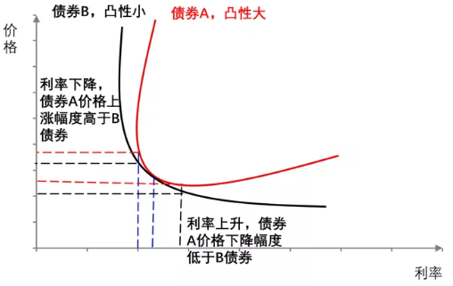
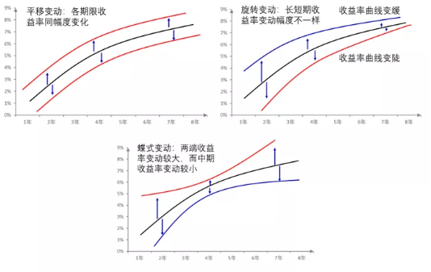

## 收益率曲线的形状

收益率曲线的形状一般来说有四种。

第一种，向上的收益率曲线。这种曲线也最为常见的，表示期限越长，收益率越高。一般期限越长意味着投资者面临的各类风险（包括流动性风险、信用风险、市场波动风险等）越大，投资者也会要求更高的收益率。

第二种，向下的收益率曲线，表示期限越长，收益率越低。这种曲线一般不多见，其出现可能有以下几种原因：一是市场流动性迅速收紧，货币市场利率快速上行带动短端债券收益率上行，最终使得收益率曲线出现倒挂，如2013年6月爆发的“钱荒”一度使得短期债券收益率超过了长期债券收益率 。二是市场对未来经济发展态势持悲观态度，预期未来收益率会下滑，于是使得长端收益率低于短端收益率。如在1990年的时候，日本市场普遍对经济发展态势持悲观态度，认为未来经济会进入衰退期，企业的盈利能力会下滑，于是长期收益率快速走低，并出现收益率倒挂。

第三种，水平的收益率曲线，表示期限对收益率的影响不大。这种现象往往出现在过渡阶段，比如在从向上的收益率曲线变为向下的收益率曲线的过程中，会出现这种水平状的收益率曲线。

第四种，驼峰型收益率曲线，表示某一期限收益率高于左右两侧收益率。这种情况的出现可能与流动性有关，目前市场上交易最活跃的券种是10年期的国开债和国债，而7年期左右的债券流动性较差，这就使得投资者会给10年期债券额外的流动性溢价，使得10年期债券的收益率反而低于7年期债券的收益率，如在2020年9月份市场就出现了7年期与10年期收益率倒挂的现象。

| 曲线形态 | 原因 |
|---|---|
| 向上的收益率曲线 | 期限越长，收益率越高，也是我们日常最常见的收益率曲线类型。一般期限越长，潜在的流动性风险、信用风险等也会越高，投资者要求的收益率也会越高 |
| 向下的收益率曲线 | 期限越短，收益率越高，即短端收益率高于长端收益率。这种形态一般出现在市场流动性快速收紧的时候，由于市场流动性不足，短期资金利率快速抬升超过长端资金利率；另外也可能会出现经济明显下行，投资者对未来投资不看好的背景下，如90年代的日本 |
| 水平的收益率曲线 | 不同期限的收益率水平近似，收益率期限利差很小。这种水平形态一般会在收益率过度期出现，比如短期限收益率快速抬升，使得收益率曲线出现熊平，或者长端收益率快速走低，出现牛平。这种态势出现的时间较短，很快会过渡到其他状态 |
| 驼峰型的收益率曲线 | 某一期限的债券收益率出现明显的上行，使得整条收益率曲线呈现驼峰型。这一现象的出现往往与流动性有关，比如2020年9月债券市场上就出现了7年期债券的收益率高于10年期的情况，2017年的债券市场也出现过M型的收益率曲线，那时候也是由于3年期和7年期收益率过高导致的。 |

- 为什么收益率曲线的形状会有明显的不同呢？

目前，市场上有好几种理论如预期理论（认为市场的期限结构取决于投资者对未来利率走势的预期）、流动性偏好理论（认为长期债券的流动性比短期限的差，潜在风险高，需要更高的收益率）、分割市场理论（长短期债券的投资者不同且互相独立，而长短期收益率是投资双方的均衡）和期限选择理论（大部分投资者偏好短期债券，让投资者购买长期债券需要更高的收益率）等都对这一现象做出了解释。

综合来看，影响曲线形态的主要因素有：市场预期收益率、债券风险溢价和凸性偏差。

（1）先说市场预期收益率。

当投资者预期未来市场利率会上升时，他们相应的会要求长期债券提供更高的到期收益率，以弥补未来市场利率上升导致的损失，此时收益率曲线就会向上倾斜。

当投资者预期未来市场利率会下降时，长期债券的潜在价值会上升，投资者愿意以更高的价格（相应的更低的收益率）去购买长期债券，以获取未来市场利率下跌带来的收益，相应的收益率曲线就会向下倾斜。

而当投资者预期未来市场利率不变时，那么长期债券的收益率会保持在现有的水平，即收益率曲线保持水平。

这么说自然很好理解，但是对市场而言更关键的是如何形成自己的预期，或者说该怎么去判断未来的利率走势。目前，市场一般从货币政策、经济基本面等角度来判断未来利率的走势，并形成自己的预期，这一部分，我们在下面讲利差的时候会讲到。

（2）再说债券风险溢价。

债券风险溢价指的是由于存在各种潜在风险（如流动性风险、市场波动风险），投资者会要求的风险补偿。如由于短期限债券的流动性好于长期限债券，而且时间越长，市场的不确定性也越长，所以投资者对长期债券往往会要求更高的风险溢价。除了与风险相关的溢价，如制度限制问题、债券供需问题、市场部门间流动性差异等因素也会导致的债券收益率存在差异。为了方便，市场一般也会使用“债券风险溢价”去表示这些差异。

相比于市场预期收益率和债券风险溢价，凸性偏差可能难理解一些，而且对收益率曲线的影响也不如前两者。简单来说，凸性表示债券价格与收益率曲线的弯曲程度，体现的是债券价格对市场利率变化的敏感程度。

> 举个例子，在其他条件相同的情况下，债券A的凸性大于债券B，这时候如果市场利率上升（价格下跌），A债券价格下行的程度会小于B债券；反之如果市场利率下行（价格上涨），A债券价格的上升幅度又会大于B债券。

这种不对称的变化使得凸性高的债券更受投资者的欢迎，他们也愿意为高凸性的债券支付更高的价格。

从期限上看，一般长期限债券的凸性会大于短期限债券的凸性。这一来使得投资者会给长期债券相对高一点的定价，那么在假设没有风险溢价和收益率变化的情况下，长期限的债券，由于凸性大，收益率水平反而会低于短期限债券。二来也意味着长短期债券对利率变动的反应程度是不同的。在市场利率下降时，长端债券的收益率往往会比短端债券的收益率下降的快一些，这会使得收益率曲线变平；反之在市场利率上升时，长端债券的收益率往往会比短端债券的收益率上升的少一些，这就容易使得收益率曲线上移变平。

由于上面说的三种因素会同时影响债券收益率，我们在分析债券收益率变化时要考虑的更加全面。如收益率曲线的快速向上变陡，既可能是要求更高的风险溢价（如流动性溢价）也可以反映市场认为未来市场利率会上行。

## 收益率曲线的变化

收益率曲线随着影响因素的变化，自然会发生不同的变化，而按照长短端收益率变化幅度和方向的不同，我们可以将其分为以下几类。

第一，平移变化。平移变化是指各期限收益率在过去一段时间里出现了相同幅度的波动，曲线形状不发生变化。在现实中，一般比较难以见到完全平移的曲线运动，更多的是近似于平移的情况。

第二，旋转变化。旋转变化一般是指收益率曲线长短端收益率的变动幅度不一致，从而整条收益率曲线变得更加陡峭或者更为平缓，这种变化也是在日常中最为常见的。

第三，蝶式与反蝶式变化。蝶式与反蝶式变化主要是指收益率曲线的长端与短端出现同方向，大幅度的变动，而收益率曲线中端的变化却比较小。

