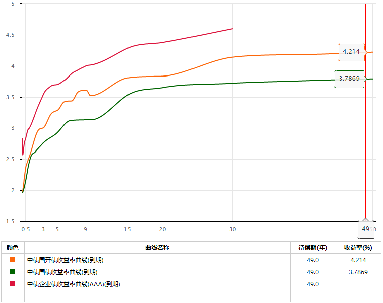
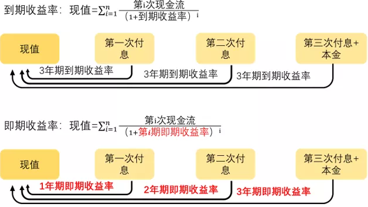
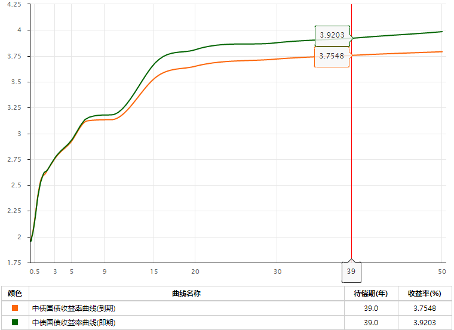
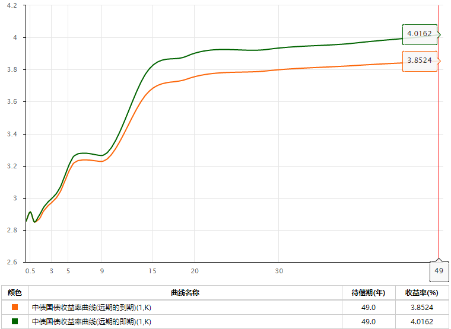

> 本文写于 2020 年 12 月，数据截至 2020 年 11 月。

收益率曲线简单来说就是描绘债券收益率与期限关系的曲线。透过收益率曲线，我们能够直观的了解在当前市场上同一类债券，不同期限的收益率水平，也能更方便的去比较不同品种收益率曲线之间的区别。

## 收益率曲线的类型

市场上收益率曲线的数量繁多，仅中债提供的各类收益率曲线就超过了1300条。为了更好的区分，根据收益率类型，我们大致可以将收益率曲线分为到期收益率曲线、即期收益率曲线和远期收益率曲线这三类，分别对应到期收益率、即期收益率和远期收益率。

（1）先说到期收益率曲线。

到期收益率曲线是由不同期限到期收益率组成的曲线。顾名思义，到期收益率指的是投资者持有该债券到期所能够得到的年收益率，也是这只债券未来所有现金流折算为当前价格的贴现率（贴现率体现资金的时间价值，比如如果贴现率是3%，这意味着1年后的103元和现在的100元，价值是一样的）。

> 假设今天我们以98.8元的市场价格买进了一张面值为100元，票息为3%，利息年付的1年期国债，同时按照95元的价格买进了一张面值为100元，票息为3%，利息年付的3年期国债。
那么，持有1年期国债到期给我们带来的收益率为103÷98.8-1=4.25%，即1年期国债的到期收益率为4.25%（贴现率也为4.25%，即未来的103元等于现在的98.8元）。
同样的，我们认为未来3年每年3元的利息以及第三年100元的本金和现在的95元的价值是一样的，即潜在的贴现率为4.8%（$95=3{\div} (1+贴现率)+3{\div} (1+贴现率)^{2} +103{\div} (1+贴现率)^{3}$）。相应的，持有3年期国债的到期收益率也是4.8%。

在实际计算时，我们可以通过市场交易数据计算获取到期收益率。而因为到期收益率比较直观的告诉了我们持有该债券到期能够获得多少收益，所以债券市场也都是用收益率作为报价单位的。比如现在市场上10年期活跃国债的报价是3.1458%，这个3.1458%指的就是到期收益率。

但透过上述公式，我们也会发现到期收益率是在假设未来各期限资金贴现率一样的前提下，计算得到的。这实际上是一个比较强的假设，因为按照我们日常的经验，不同期限的资金应该有不一样的价格。

于是，市场提出了即期收益率，对应的是即期收益率曲线。它是指在持有期没有现金流的利率，比如我们去银行存定期（到期后一次性偿还本金和利息），2年的定期存款利率为5%，那这个5%指的就是2年期的即期利率。

不过银行计算利息一般是按照单利计算，比如存了100元2年期的定存，那么到期后，我们能获得100×（1+5%×2）=110元；而如果是按照复利计算的话，那么2年后我们能够获得$100\times (1+0.05)^{2}$。

与定期存款类似的是零息债券，它在整个存续期里都不会支付利息，而是在到期后按面值偿还，即投资者持有零息债券所获得的收益率就是即期收益率。比如市场上2年期零息债券的收益率为5%，就表示2年期的即期收益率为5%，有些资料也会将即期收益率称为零息收益率。

与到期收益率不同，即期收益率是假设未来不同期限的资金对应的收益率（贴现率）不一样，且一般长期限的即期收益率高于短期限的即期收益率。

这样的确更符合实际，但也存在一个问题，就是即期收益率不能直接通过市场交易数据得到。依旧是刚举过的例子，如果我们买了一份利息年付的3年期国债，那么在计算时，我们会发现在一条公式中，存在3个不同期限的即期收益率。

$95=3{\div} (1+1年期即期收益率)+3{\div} (1+2年期即期收益率)^{2} +103{\div} (1+3年期即期收益率)^{3}$

因此为了获得即期收益率，我们需要通过到期收益率来反向推导即期收益率，这种方法也被称为“拔靴法”。假设市场已经知道各期限的到期收益率数据，其中1年期、2年期和3年期的到期收益率分别为4.25%、4.6%和4.8%。假设国债均按年付息，票息为3%。因为1年期的国债期间没有任何现金流，所以我们有：现值=103÷(1+1年期即期收益率)= 103÷(1+1年期到期收益率)，即1年期即期收益率=1年期到期收益率=4.25%。在获得1年期即期收益率后，我们可以推导得到2年期的即期收益率等于4.61%（$现值=3{\div} 1.0425+103{\div} (1+2年期即期收益率)^{2}$）。类似的，我们使用1年期和2年期的即期收益率就能够得到3年期的即期收益率为4.84%。

通过倒推的方法，我们可以逐一获得不同期限的即期收益率，并得到即期收益率曲线。

与到期收益率不同，即期收益率更多的是被用于债券的估值定价，而很少被用于债券的交易。比如发行人要发行一张面值为100，票息为3%，按年付息的2年期债券，那么他便可以按照现有的即期收益率曲线将未来的现金流逐一折现，计算该债券的现值，并以此为依据来进行债券的定价。

最后，我们来讲远期收益率曲线。

相比于即期收益率和到期收益率，远期收益率会复杂一点，比如到期（即期）收益率我们可以直接说3年期的到期（即期）收益率是多少，但是如果表示远期收益率我们就要说明这是几年之后期限是几年的到期（即期）远期收益率。一般我们会用y(n,k)，表示n年后，k年期的即期收益率，比如y（1,2）表示的就是1年之后，2年期的即期收益率，如果特别说明也能表示远期的到期收益率。类似于即期收益率，远期收益率也不能通过市场交易数据获得，而需要通过即期收益率曲线等推导得到。

需要注意，我们这里讲的远期收益率是推导出来的市场隐含远期收益率，并不能代表市场对远期收益率的预期。

远期收益率推导的核心思想是：一个人如果要配置一份总期限为3年的资产，那么无论是直接购买3年期的零息债券还是先购买2年期的零息债券，2年之后再购买1年期的零息债券，这两种资产配置方式带来的收益应该是一样的。如果不一样，投资者就只会购买收益率高的组合。比如，如果直接购买3年期的零息债券获得的收益率更高，那么投资者就只会购买3年期零息债券，反之则相反。在市场的作用下，最后这两个组合所能够获得的收益就应该是一样的。

> 
举个例子，假设市场已知即期收益率曲线，其中1年、2年和3年的即期收益率分别为4.25%、4.61%和4.84%。那么投资者投资100万3年期的零息债券（复利），3年后能够获得115.2万元（100×1.0484^3=115.2）。相应的，他如果先投资100万2年期的零息债券，再投资1年期的零息债券也应该能够获得115.2万元，即100×1.0461^2×(y(2,1)+1)=115.2，计算得到 2年后1年期的远期利率y(2,1)=5.3%。

通过这样的方法，我们在知道即期收益率曲线之后，就能逐步获得相应的远期的即期收益率曲线。具体计算公式为：

$\left [ 1+y(n,k) \right ] ^{k} \cdot (1+n年期即期收益率)^{n} =\left [1+(n+k)年期即期收益率  \right ]^{n+k }$，总时长为n+k期。

除了用即期来推导得到远期的即期收益率曲线，市场也可以通过到期收益率曲线来推导得到远期的到期收益率曲线，这里我们就不再展开了。

综合来看，这三种收益率曲线各有不同，其中到期收益率曲线是计算其他两类收益率曲线的基础，往往是先通过市场数据得到到期收益率曲线，然后由到期收益率曲线推导得到即期收益率曲线，最后由即期（到期）收益率曲线推导得到远期的即期（到期）收益率曲线。

从用途上看，到期收益率是在进行市场交易时最经常使用的收益率指标；即期收益率则主要被用于债券的估值定价；远期收益率更多的是用于利率模型的构建，在日常交易中使用不多。

之后，我们提到收益率曲线时，如果没有特别说明一般指的都是到期收益率曲线。

|  | 含义 | 构建 | 用途 |
|---|---|---|---|
| 到期收益率曲线 | 到期收益率是投资者持有债券到期能够获得的年化收益率，也是使债券未来所有现金流折算为债券当前价格的贴现率 | 到期收益率的构建基于市场成交数据，通过样本的成交数据来获得关键期限的到期收益率，再通过数学方法获得收益率曲线 | 这是交易时最常用的数据，投资者可以根据该曲线了解目前市场的行情 |
| 即期收益率曲线 | 即期收益率也被成为零息收益，是指再存续期内没有现金流的收益率 | 由到期收益率曲线推导得到 | 多用于债券的估值定价 |
| 远期收益率曲线 | 分为远期的即期收益率和远期的到期收益率，体现的是隐含的远期收益率 | 由即期收益率曲线和到期收益率曲线分别推导得到 | 一般用作利率模型的构建 |
