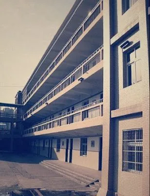

惊闻以前高中的教学楼被拆，同学们纷纷表示惋惜之情，霎那间往事涌上心头，回忆并诉说着曾发生在那儿的所有所有……

其实那栋楼年代不算久远，好象是上世纪80年代修建，在几年前似乎还曾翻修过外立面，所以无论质量还是外观，都没有重新修建的必要，那么唯一的解释就是学校换了新任校长，为了让自己在离任后有些“功绩”留给后人，教学楼成了筹码。

其实对这所学校我并没有太多的回忆，因为除了最后一年，绝大部分时间我都是个调皮的孩子，被老师罚站、去办公室、叫家长这些都是家常便饭，所以有时候看到那栋楼心里还有点怕怕的感觉。不过许多年后，它终于没能熬过我，让我想起以前一位英语老师的话“笑到最后，笑得最好”，终于我考上了大学，我笑了；它倒了，我依然健康的活着，我笑得最好。哈哈哈哈哈哈哈哈哈哈……
我来一一盘点学校给我的回忆。

一个美术老师“蒋XX”，我记得他的名字，但为了免去可能的麻烦，隐去了名。他的一句口头禅就是“你们不要老讲，老讲！”所以其实他的年纪不太大，可我们还是叫他“老蒋”，可见人的确是被喊老的。其中有件事很搞笑，上美术课的时候，他都会带一袋子A4打印纸来给我们当画纸，发下去之后，他布置一个题目让我们画，自己就不知道干什么去了，（其实现在想想，当个美术老师其实也是人生一大悲哀，整天面对一群孩子，唉，没有理想，没有追求，这一人生甚至没有丝毫乐趣。）那时候我坐在第一排，每次他出去之后，我和另外几个同学就把纸袋子里剩余的A4纸全部拿光，等他回来的时候偶尔会发现少了纸就会在全班查谁偷了纸，但是群众的智慧和力量是无穷的，我们总是把纸全班转移，最终“老蒋”当然是徒劳无功，每次看到他困惑的双眼，我们就在下面暗笑，嘎嘎嘎嘎……

我想每个学生都会在学生时代给老师起各种各样的“昵称”，我们那时候也一样，诸如一位老师经常搽香水，而且那香味几乎能在半个街区都闻到，我们叫她“香妃”，因为那会儿《还珠格格》很流行。她有很多经典的话：“丑女多作怪”、“笑到最后，笑得最好”、“学生就要又红又专”、“我也就是为了你们这一届，有感情了，不然我去国外卖烧饼，那挣钱还不比在这当老师强多了啊？”等等诸如此类的话，最后想想确实这些话都是金玉良言。因为在大学的时候，看看课堂上整天拿个小镜子照来照去恨不得把镜子照穿的那些女生大多都是丑女；毕业了才知道考大学、考研一切一切神马都是浮云，完全不如烤烧饼、烤山芋、卖烧烤之类的赚钱。

语文老师的昵称更绝，叫“金丝猴儿”。老实说，我完全不知道这个昵称怎么出来的，似乎一夜之间就全年纪知道了，好比现在粮食价格涨价，也没有谁通知，但妈妈级别的人总是最先知道这回事。既然大家都这么叫，那我也不能脱离群众，不过很不幸的有一次被老师听到了，悲剧的结果就是期中考试本来考了61分，结果老师硬生生地把作文多扣了2分，59，挂了！唉，说起来都是眼泪。

祝愿学校越来越好。
