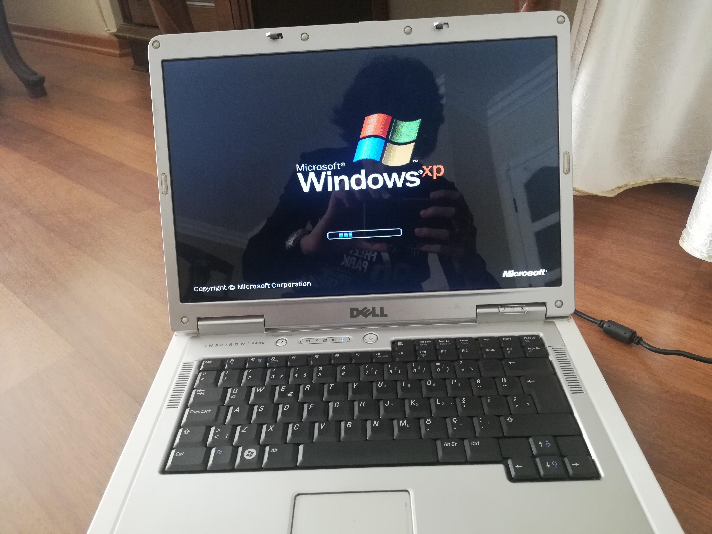
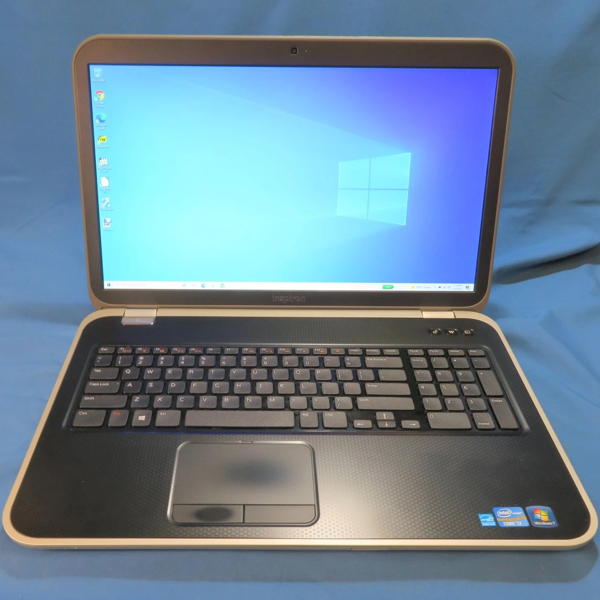
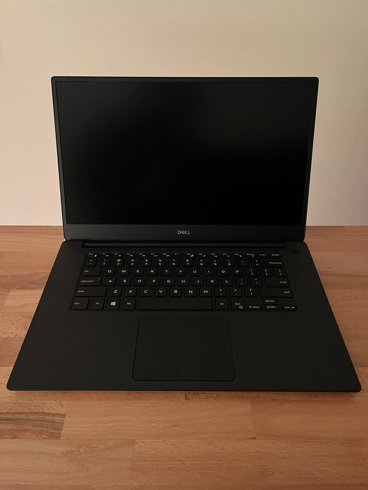

我是一个比较喜欢科技产品的人，目前同时拥有5台电脑，四台笔记本中两台Windows、两台Mac；同时我还是一个非常专一的人，两台Windows都是Dell。前段时间因为“少女魔抓”的凌辱，我其中一台Windows的外壳被抓的千沟万壑，导致许多开发工作都转移到Mac上去了，这台Windows就没事看看电影用了。毕竟时间太久了，一天晚上电池鼓包把触控板给顶起来，我在考虑要不要更新换代一下。但该说不说人上了年纪就知道节约了，要放在五年前，我肯定想都不想换一台。但是现在我默默的评估了一下，维修一下或许还能再坚持5年。这里需要特别感谢维修小师傅不辞辛苦，拆机两次，效果非常好。

我从2005年开始用Dell笔记本，记得那是在杂志广告上第一次看到Dell inspirion 6400，破天荒的用了Intel Core Duo T2300双核处理器和 1 GB内存，在那个普遍AMD 1.8 GHz+256 MB的时代，能把这么强的硬件塞进一个笔记本，震撼程度不亚于特斯拉能飞。从2005年一直到2015年十年间，它陪我写完了两次学位论文，也陪着我写过无数的业务材料。它见证了我从一个学生到金融职场熟练工的蜕变。很遗憾的是，我没能很好的保存它，我都记不清它最后去了哪儿；我甚至没有保留哪怕一张它当年的照片，只能在模糊的记忆中想起它的模样。这里借用网络的一张图片，谨以此纪念人生中的第一台Laptop。

很快，人生中第一次重要提拔来了，6400也完成了它的阶段性使命。我当时的内在矛盾，已经是我对于计算机高速硬件性能要求同落后的6400性能瓶颈之间的矛盾，已经是我对于玩“使命召唤”要求显卡性能迅速发展的需要同当前GMA950集显运算能力不足的状况之间的矛盾。就这样，Dell inspirion 7720上线了。它当时吸引我的有两点：一是17寸大屏，这么大的显示屏打游戏，啊不是，工作起来多过瘾；二是可以自己增加内存和硬盘。我自己给他扩容到16GB + Intel 酷睿i7 3630QM，写起工作材料多爽。这台电脑陪我度过了我两次提拔的人生阶段，在孤独的异乡，我用它击沉了一艘又一艘的战舰，度过了一个又一个夜晚。后来它被替换的主要原因是处理器性能实在跟不上计算需求了，现在的它已经太老了，以至于周边橡胶缓冲材料已经变得干硬。于是我又用它的小弟Dell XPS 9570代替了它。这里还是上一张它的照片感谢一下它陪伴我走过的日子。

Dell XPS 9570这个型号是Dell当时风靡全球的产品，不得不说那时候的Dell配得上当时的市值，简洁的设计、强悍的性能，性能强大到以至于8年后的今天它干活仍然是从从容容、游刃有余。但是碳纤维的外壳有一个特别不好的点就是随着时间流逝碳纤维居然会老化，所有被碳纤维覆盖的地方都会变成嚼过的口香糖一样黏糊糊的，让人非常嫌弃。以至于很长一段时间我就放在那儿用作电影播放器。俗话说的好，不破不立。在被魔抓凌辱之后，为了让他继续在原有岗位上发光发热，我为他量体裁衣定制了一套崭新的外衣和电池。修复完了之后真的像船新电脑一样好用。

修复结束后看到这崭新的电脑，我居然有点隐约的成就感，这种成就感的来源并不是我自己修复了它，而是我在他本来还有使用价值的时候并没有放弃它，同时之前因为破烂不堪的外壳我甚至开始嫌弃它，而导致这种局面的一部分原因也是我没能好好地保护它。现在我把它修复好了，就像是杂乱的屋子收拾出了一幅井然有序的摆设，心情都会变好。

这放在以前我根本不会这么考虑，我只会想着换一台电脑，倒不是因为钱的问题，而是我觉得年轻的自己没有想过或者没有太多的能力去处理已经混乱的局面，现在随着年纪的增长慢慢有了这种能力，不会再想着推倒重来，而是想着在现有的基础上怎么利用现有资源最大化地满足目标推进的需求。这种感觉就是我上面提到的成就感，同时这可能也是一种成长的必然结果。

要说为什么会对Dell情有独钟，这倒是真的没有什么特殊原因，也可能就是第一台笔记本是Dell，它也没有给我带来太多不好的购物体验，产品也基本能够满足自己的情况下，继续使用也没有什么不好。至于后面会不会换到其他的品牌，我觉得大概率不会，因为新款2026年的Dell XPS真的太帅了，主要是国内买不到64GB的版本。AI时代内存容量和带宽真的太重要了，我的Macbook Pro上了48GB还经常不够用，不然可能也就早入手了新款。

希望这次重生可以再次陪伴我度过人生中一个又一个值得记忆的美好瞬间。
