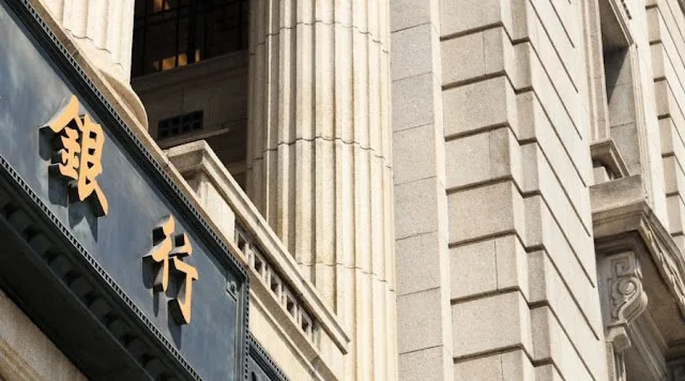

博客一直没有更新，对不起常来看我博客的朋友们了，你们的留言我看到后已经一一回复了，再次说声抱歉。造成现在局面的一个主要原因，就是即将毕业的我走上了一条不归路——坐台、接客。

在没有毕业的时候，我和广大应届生一样不知道以后能做什么，择业目标只能根据人云亦云的说法瞎撞，金融、地产、快销等高收入行业成为我们重点关注的目标。在去年十月的招聘月里，我大大小小参加了几十场招聘会，并通过面试、笔试等若干环节，终于把目标定在了金融和地产上，最后在国内经济形势未能在能看到的将来好转的情况下，舍弃了高薪的地产，转而投向银行的怀抱。

在没有进银行之前，它给我的第一感觉就是高薪、闲散和态度差，我总是在想，没想到当了那么多年弱势群体的我，今天居然也能在这种垄断性行业俯瞰芸芸众生。并能为自己顺利通过层层选拔进入金融行业而沾沾自喜，洋洋得意。孰料，一场前所未见的黑色阴云笼罩在我自以为光明的前方。

在入行培训之后没多久，我被分行分配到了一家支行接受基层锻炼。刚去的时候我充满信心，我暗自鼓励自己一定要认真学习各项业务，对于任何工作都抱着100%的热情，向支行的领导和同事们虚心学习经验。这劲头有点像响应毛主席号召的“上山下乡，知识青年接受贫下中农在教育很有必要”的指示。但是一个月快过去了，我慢慢觉得刚开始的那种雄心壮志已经无影无踪了，像是每年一次的钱塘江大潮，来的猛烈，退的彻底。以下就是造成这种心理变化的原因，也是我痛苦难耐之处。

1. 早上我得六点钟起床，天还没亮的时候洗漱完毕，急急忙忙的赶公交车。我保证大家想象不到那公交车有多挤。不夸张的说，一个站台上站150+是不成问题的，十五分钟一班车的频率让每个赶早班的人都望眼欲穿。在晃晃悠悠的小双层公交上，你不用扶着都不会倒，2块钱的空调车会给你家一般的享受。在被人踩&踩别人的挣扎中一小时后终于到了支行，其实有没有迟到得看天意，因为公交车司机你无法掌握，押送款车的司机你也无法掌握。这中间的尺度好比我站在你面前，你却不知道我是基友那么遥远。

2. 我从没见过有比银行柜员还严格的工作要求，现在简单罗列如下：你不能拿出手机看，会被通报；你不能在监控下喝水，会被通报；你不能穿除黑色皮鞋之外的鞋，会被通报；你不得留超过2.5cm的头发，会被通报，但也不能是光头，也会被通报；你不能手上有小动作，会被通报；如果你没有说“请”“谢谢”“对不起”“麻烦您”之类的字眼，会被通报；你更不能咧开嘴哈哈大笑，会被通报；你XXXXX，会被通报；会被通报；会被通报……

3. 中午大家去吃饭的时候，当班的柜员被要求坚守岗位，只能吃大家给你带回来的午饭，而且如果有顾客在，你不能吃饭，只能等没有客户的时候才能吃饭，鬼知道那饭有没有结冰。此外，吃完饭你不能午睡之类的，因为你时刻得提防有顾客“骚扰你”。即使没有顾客，你也得像个怨妇一样眺望门口，期盼有个客人上门，好让你知道你这个台还是有人光顾的……

4. 到了晚上交接班的时候，你得打印乱七八糟的报表，得有比你高一级的职员帮你清点余款和账面是否相符，如果相符，别得意，这是你必须应尽的义务；如果不符，那你就中奖了，不管你能不能补救损失，分行都得通报批评并处罚金，如果无法追回损失，你还得赔偿。

5. 所有这些做完后，你还得完成行里给你下达的一系列任务指标，例如：日均存款多少万，时点存款多少万，信用卡多少张，储蓄卡多少张，开户多少人，代发工资多少个……同事跟我说，一人在银行，全家跟着忙。

其实还有很多很多在我看来很不人性化的规定，我不知道为什么这么严格的规章制度下，顾客对于银行的服务还是不满意呢？起码我爸妈就经常抱怨银行怎么怎么不好，在我看来，这种所谓的规章制度完全是将制度奉为一切行为的苍白圭臬。领导完全不了解员工需要什么，完全不了解制度是否合理，也许不是每个领导都从柜员做起的。

虽然有种种的不习惯，但我仍然很庆幸能够进了金融业，或许我不会一辈子都在这个行业里打拼，起码这是我现阶段想要的经历。我希望在这篇文章写了之后，每个人看到的人能够去银行办理业务的时候多多体谅柜员，他们并没有得到银行业暴利的一分钱，他们拿得只是银行最底层的工资，却承受了很多的工作压力。我在半年后可能转岗不做柜员了，但我只希望在柜员的一天我能顺顺利利的做好这份工作。

另外，特别感谢在我实习中的支行同事们！
