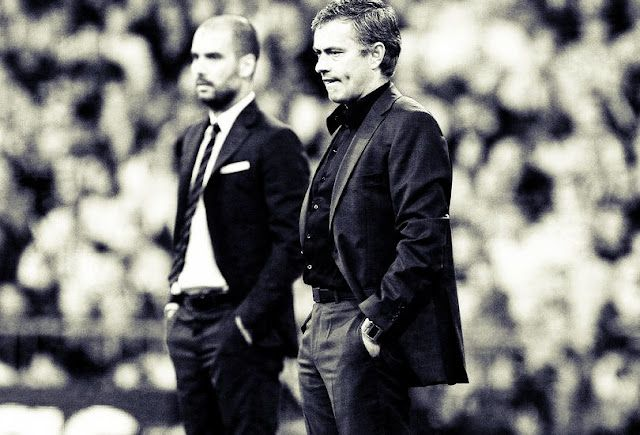
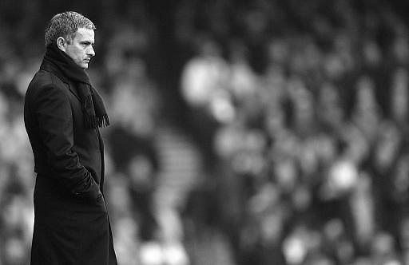

一、 佩普·瓜迪奥拉终于不可避免的选择离开诺坎普，离开那个成就彼此的天堂，仿佛深爱着的恋人满含泪水却总因为种种原因不得不选择离开，只是在那一瞬间，除了眼泪你不可能做更多的什么。

要说地球上的名帅你可以说出很多，包括英格兰的温格和弗格森在内的顶级名帅无不让人敬仰和钦佩，但是能因为一个做过几年主教练却让你为一个男人感动甚至流泪的，我所遇到的只有两个——何塞·穆里尼奥、佩普·瓜迪奥拉。他们有着截然不同的性格和思想，却也有着共同的原因感动人们：缔造了一个属于俱乐部亿万球迷的巅峰帝国。他们二人都没有执教过国家队，即使在俱乐部也并未像温格和弗格森一样数十年如一日坚守着他们深爱的主场和捍卫着那一身血色战袍，但他们所到之处，从来不会缺少鲜花、掌声、荣耀、辉煌和眼泪。他们用专注和隐忍向世人昭示通往巅峰的天路，也用白发和皱纹揭露荣耀背后的汗水。

有人说，看一个人的底牌，要看他的朋友；看一个人的价值，要看他的对手。我想世界上只有他们俩能称之为彼此的对手，也只有他们俩能品尝到彼此孤独的滋味，在屹立于无上荣耀之上的只有无限落寞与孤寂，在徜徉于云端之上，他们所能看到的只有胜利。

瓜迪奥拉开创了一个时代，一个被克鲁伊夫全攻全守理念影响终身的人创立了一个被全球足球学校奉为足球经典教科书的全新理念，大气磅礴的场面，行云流水的配合，真的不像地球人的玩物；穆里尼奥追求功利效率，静如处子，动若脱兔，在万千攻势中只须发现一个弱点，必让对手功亏一篑。我不知道这两种理念哪种会更完美，但就效果来看，双方各有利弊，因为两位高人的理念和功绩是一座座沉甸甸的奖杯娓娓道来的。

男人的世界女人永远不懂，她们不理解这么一个小圆球为何有如此的魅力以至于让诺坎普十万人高歌，也不理解在2010年的欧冠之夜穆里尼奥在灯光下的散步会让人如此心碎和无奈；她们更不理解佩普对何塞的心语：我确信某一天，我和他（何塞）不再是主教练时，我们会在一起共进晚餐。

虽然我不是很喜欢巴萨，因为这支宇宙队不仅有着奥斯卡影帝、无敌干爹模式，而且在全欧洲大部分俱乐部都以公司制自负盈亏的时候，他用独特的会员制肆无忌惮的利用财力左右着优秀球员的心，但这完全不影响我喜欢的佩普·瓜迪奥拉。就像何塞喜欢嘲讽和挖苦对手，还会攻击巴萨助教，也一样不影响我欣赏他的不羁。我所关心的是在这一段段小插曲的背后，他们究竟给我带来了什么，让我看到了什么，他们又给世界留下了什么，洗净铅华，剩下的那一滴感恩的泪水才是他们来过的证据。

二、国际米兰双杀AC米兰，也同时告别了下赛季欧冠和21世纪重现的大国际时代，马特拉齐离队、科尔多巴退役、麦孔费力的奔跑在那熟悉的右路、小萨仍然飞奔全场却没有了当初的稳健和从容、塞萨尔一次次无助地目送皮球飞入身后的球网，我知道，他们都累了，莫拉蒂累了，蓝黑色终于迎来了属于自己的夜晚。我感激他们为蓝黑做过的一切，感激他们曾给我带来的美好，也看到他们拼尽全力却仍然没能阻止坠落的蓝黑。

但即使这样，拥有100多年豪门底蕴的神圣战袍却不容被践踏，面对鸡肋般的米兰德比，支撑老将们拼搏的是不屈的蓝黑精神和当年傲对群雄的豪气，仿佛河边衰迈的战象，浑浊的目光被血色夕阳余辉照耀的那一刹那，他仿佛看到了曾经奋勇杀敌的弟兄为了胜利而战，这样的情景足以让它重回当年，昂首仰视即将落入地平线的夕阳怒吼……

三、心情很乱。
