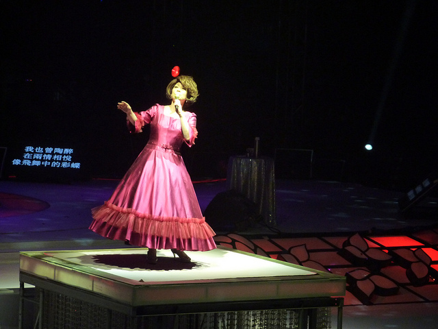

晚上去看了今年第一场演唱会——建行之夜·蔡琴“新不了情”世界巡演2012新年演唱会（谢谢友情赠票）。看过后的唯一感受就是我喜欢听这个比我妈还大的女人唱歌，而且第一场演唱会的眼泪居然是给了这个美丽的女人。

首先得谴责一下百度地图骗了我演唱会地址，在Google打不开的情况下，用了坑爹的百度，居然把我带到了一个陌生的郊外，等到我在赶到演出地点——奥体中心已经离正式开演只有十分钟了。

在蔡琴出场的时候，全场雷动，但这时的掌声和欢呼纯粹是起哄的意思，起码我是这么认为。在第一首歌《出塞曲》之后，蔡琴开始第一次讲话，我能清楚的看到她的提示版上写着“TALKING”，可见她对这次世界巡演的准备充足。她的谈话中无不显露出这个已过知天命的女人的自信和骄傲，但同时也会用自嘲一番，所有的讲话和动作都显得那么优雅，足见她对舞台和场面的控制力，不得不说1980年出道的蔡琴到今天的30年的确是货真价实的30年。
演唱会中间，发生了数次催人泪下的片段，而每次的内容却不尽相同。
第一次是在蔡琴唱《爱你太浓》的时候，她那醇厚的女中音伴着灯光的效果，缓缓唱起爱你太浓，我看着大屏幕的歌词，瞬间有种哭的冲动，那样的感觉太奇怪了，蔡琴唱歌之前说起了她1996年之前的婚姻生活。在1995年的时候，她和丈夫离婚了。她说在结婚的时候，她也想做一个好太太跟丈夫白头到老，但是终究没能牵着心爱男人的手走完人生。她说了一句让我感动很震撼的一句话：“男人或女人身边的另一半如果让你感觉他/她很坚强，你千万不要以为他/她天生就是这样，那只是因为爱你太浓。”大屏幕并没有多少真实再现或蔡琴拍摄的艺术照渲染，就在那灯光一闪的瞬间，我被她的歌声唱哭了。在音乐还在继续的时候，蔡琴下去换衣服，但是我的眼泪却一直在眼眶里打转，我从没有被一首女人唱的歌感动过，确切的说在此之前我不怎么听蔡琴的歌，我无法想象我居然能被感动成这样。
我身边的姑娘更是夸张，抱着头哭，我都不知道怎么劝，因为那时我也含着泪，万一劝着劝着我也抱头怎么办？这时候的掌声已经纯粹的掌声，没有开场时的欢呼声和口哨。
第二次是在唱《爱断情伤》的时候，她开始叙述自己的故事。1980年蔡琴出道，在第一首歌唱红之后，她瞬间成了台湾唱片公司的大红人，据她自己介绍，每次她的新唱片发行后的一周，她所在的唱片公司的老板就会换一次车，一个月后员工集体加薪。但是在1996之后，唱片公司开始慢慢的减少对她的投资，即使给她灌唱片也是很应付的那种，老板再也不会像以前一样亲临录音棚。在考虑了很久之后，有一天晚上蔡琴终于鼓足勇气走到了她老板的家里问她的老板自己是不是上了公司的“黑名单”——一份即将解约艺人的名单。她的老板也是女人，听完后哭了，老板说不仅是你，包括所有1980年前后出道的女歌星都得给新人让路，公司已经决定不继续跟她们合作了。蔡琴那晚回家之后哭了几个月。她说她唱歌不是为了名为了利，而是她真真正正喜欢唱歌，而且她发现自己除了唱歌以外什么也不会。
在沉沦了几个月的时间后，她报名参加了舞台剧培训班，因为她意识到社会变了，大众更愿意接受新人而不是她这样已经失去巨星光环的年长艺人。在舞台剧培训班里，她要从零开始跟所有的新学员一起学表演、跳舞和发声，她说自己在那一刻不是以前的蔡琴，而是个零。
也许是自己的努力和遭遇的不平等感动了上天，在舞台剧培训班学习后没多久，她接到了大陆的一个导演（名字不熟，忘了）的电话，问她愿不愿意试唱电视剧《雷雨》的主题曲，而且试唱了之后不一定就给蔡琴唱。蔡琴说她一连说了几个好，因为这是她唯一的一次机会了，她不能放弃。在试唱了许多许多许多遍以后，她忐忑的将录音小样寄到了北京，一直守在家里等着北京传来的消息。但一周过去了，两周过去了，蔡琴一直没有接到导演的回复，直到她觉得不会再有转机的时候，北京导演组来了电话说：“你等了很久吧？但再久的等待都是值得的，恭喜你，《雷雨》的主题曲是你的了！”蔡琴说这是她事业的第二个高峰。
虽然现在说起来，你无法看出蔡琴心里究竟怎么想，甚至你会看到一脸的轻松，仿佛在说一个别人的故事，但我真的为她的过去感动了，我真不知道她居然是一个如此坚强的女人。我想只有经历过这一切起起伏伏挫折和磨难的人才能懂得什么叫无我、无相的境界。

第三次是在演唱会结尾的时候，她唱起她第一首冠军歌曲——《恰似你的温柔》之前说：“每个人都会有心底的故事，但是别让这些故事束缚了你，坚强起来，洒脱起来，生活依然美好。就像我在1996年的时候，那时是我最悲惨的时候，1992年我的父亲去世了，1995年我离婚了，1996年我被公司通知解约。即便这样我依然站了起来。”讲这番话的时候她很有内涵，非常淡定，好像看透了世间的一切，那份内敛的傲气始终感染着在场的每一个人。我不由得想起自己也有很困难的时候，也许未来的日子也会有这样的时候，可生命还得继续，只要自己还有希望，路依旧会很长。

> 这不是件很容易的事
> 我们却都没有哭泣
> 让它淡淡的来
> 让它好好的去

她一直让现场的观众重复这几句歌词，她说当你想起自己的故事再来品味这几句歌词会发现歌词写的很有意义。每个人都有不容易的时候，但是请不要哭泣，所有的事我们无法避免的时候只能默默承受，当事情过去之后再来回想，你会发现当初你看来很不得了的事情“淡淡的来”，也会“好好的去”。我觉得她说的时候特指她那份让她受伤很深的感情，感情来的时候不会轰轰烈烈，但走的时候也没必要满含怨恨，一切随缘。
就这样，在掌声和感动中结束了她的演唱会，我不知道她演唱会的下一站是哪儿，人生的那一站是哪儿，不管怎样，谢谢蔡琴带给我如此美好的一夜，不仅歌声美好，绕梁三日；更感谢她带给我的感动和让我敬仰的坚强。
无论你的下一站是哪里，带上我的祝福！
