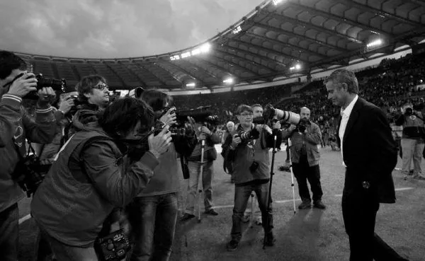

恐怕再也没有一支球队在一年之内能经历如此多的欢笑和泪水。2010对于国际米兰注定是一个涅磐至沉沦的感慨年份。

2010年5月22日的伯纳乌，时隔45年之后蓝黑军再次站上欧洲之巅、世界之巅，三冠荣耀加身让每一个蓝黑拥趸、名宿、集团成员无不狂欢；同年的2010～2011赛季，穆里尼奥带着球迷的眼泪、莫拉蒂的挽留以及所有意大利人的祝福离开了梅阿查远赴伯纳乌入主皇家马德里。而蓝黑军在新任主帅贝尼特斯的带领下，缺失了穆里尼奥的血性和信念，一次次的爆出冷门：“昔年”的三冠王威风不再，而这“昔年”仅仅5个月而已。其实新赛季的惨淡成绩也并非全是贝尼特斯的责任，首先贝尼特斯是受命于危难之间，在赛季即将开始的时候匆忙上任；国米高层几乎没有给予新主帅任何支援，在建队理念迥然不同的情况下，用的仍然是上赛季阵容；全队上下对已经离任的穆里尼奥怀有无限情感，无法与新任主帅有效沟通；伤病满营，一线队伤病最多达到10人，这样的阵容无论谁带队成绩都不会多理想。只能说贝尼特斯运气不好。

更悲剧的是，2010金球奖和最佳教练居然没有三冠王的份，这让我很不理解。因为即使新赛季国米的成绩不理想，可是上赛季的三冠王是有目共睹，而且本来这两个奖项的最有力争夺者：斯内德和穆里尼奥居然都没有得奖，让我怀疑这两个奖项的评审委员会看不看球。

斯内德的落选倒没有让我太震惊，虽然上赛季的三冠王让这位荷兰国脚成为世界足坛的焦点，他的大局观和出色的脚下技术以及积极跑位都足以和世界一流中场相媲美，但金球奖的其他候选人例如梅西和哈维也同样具有相当的实力，如果说斯内德的落选让人意外，那么只能说斯内德的运气不好，或者他在上赛季和2010的世界杯上用完了他的好运。不管怎么说，斯内德依然是世界足坛近5年内最出色的中场之一。

而穆里尼奥的出局却让我大吃一惊，世界最佳教练居然让博斯克拿走，我实在不知道评委会的评委们什么评判标准。以2010世界杯西班牙的阵容放在任何一个知名教练麾下都足以捧起永恒的大力神杯。圣卡西、普约尔、皮克、哈维、伊涅斯塔、法布雷加斯、比利亚、博扬、托雷斯……哪一个不是世界顶级球星？这样的一个阵容如果还没能捧起大力神杯那一定是教练的耻辱，我无法理解这样一个本来理所应当的事情居然被评委会看得如此之重。

穆里尼奥，12年前的一个普通的葡萄牙籍足球翻译，曾带领波尔图这种欧洲四流球队捧得大耳朵杯、曾带领切尔西连续四度夺得联赛冠军、以史诗般的胜利击败曾不可一世的巴塞罗那二度捧起大耳朵杯、2008年受莫拉蒂的邀请入主梅阿查并于2010年创造了蓝黑军团历史上首次三冠王的教练居然没能拿到世界最佳教练，可悲，更可笑！

看看三冠王的阵容：米利托（31岁，未曾嫁入豪门）、埃托奥（28岁，世界顶级前锋）、斯内德（24岁，皇马弃将）、斯坦科维奇（31岁，蓝黑老将）、坎比亚索（28岁，顶级后腰）、潘德夫（26岁，凑数级别的前锋）、萨内蒂（36岁，蓝黑 元老）、萨穆埃尔（30岁，一流中后卫）、卢西奥（30岁，一流中后卫）、麦孔（28岁，顶级后边卫）、马特拉齐（37岁，替补）、科尔多巴（35岁，替补）、塞萨尔（29岁，顶级门将）。这样一支球队，意甲年龄最大的球队之一，主力受伤连相当的替补都没有的球队正是穆里尼奥灌注的血性和信念造就了辉煌的2010，难道这样的教练配不上世界最佳教练名头？
无奈，结果既成事实，蓝黑依旧深邃，生活仍将继续。我只能对远赴马德里的穆里尼奥、仍在梅阿查的贝尼特斯和继续奋战的蓝黑众将士致以祝福！
