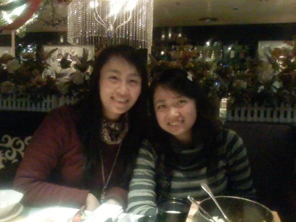

早就说要聚聚，昨天终于抽了一天空见几位中学很好的同学。

不知道是不是长大了，她们都喜欢化妆，涂上眼影、唇彩，染了头发，已经不再是那个“同桌的你”。 晚餐去的绿茵阁，其实我向来不大喜欢吃中式西餐，总感觉吃不饱，完全没有中国菜好吃，你说晚上要是点些什么牛羊肉，白斩鸡，清蒸鲈鱼什么的多好啊，非得吃什么西餐，我挑来挑去点了个“非洲鸡”，相当不好吃，不过感觉不错。席间听了两位钢琴师的弹奏，相当好听，让我想起了大学一个要好的哥儿们，在我的毕业专场上为我弹的那一曲。

王同学非要给我照相，我百般推脱之后终于作罢，让我给她们照，不过实在抱歉，不知道是因为相机不好还是我技术不好，总之照片不能看，后来用我手机照的还是不错的。

吃饭时候说了很多中学开心的事情，让我忘了很多不开心的事情，好像时光瞬间回到了十年前。说到以后，陈同学本来想要去澳洲定居，可是现在移民比较麻烦，我觉得在国内混好了也是一样的，毕竟国内还是好点的。其实她也挺想在国内，世事变化无常，谁知道以后会怎么样呢，不过希望她能好运。

吃完饭后，另一个同学来了，“张婉秋”。这名字听起来相当婉约，其实特开朗一女孩，个儿也挺高，173cm，还是净高。记得中学的时候，她和男孩一样，有打有闹的，但是人很好。很开心在上海还能有那么多同学，想到两年后会去那比较开心，毕竟离开一个充满回忆的地方寻找一个新的环境重新开始是一件相当令人振奋的事。中间有个特别搞笑的故事：在车上的时候，陈露闲着没事，就说我想起以前高中讲过的一个故事，是东北大猪的笑话，她就给我们说的绘声绘色，张婉秋还带了个同事来，我们都笑得不行，她同事一句话没说。后来到了KTV门口的停车场，找车位，她那个同事很彪悍的下了车，风风火火的找车位，我们都说这个女孩相当雷厉风行。张婉秋对陈露很紧张的说，她是东北人，你别再说什么东北大猪的笑话了，她公司还欠我公司23万呢，我不敢得罪她。哈哈，我们笑死了。

晚上11：50，到家，玩了一局 Age of Empires。
