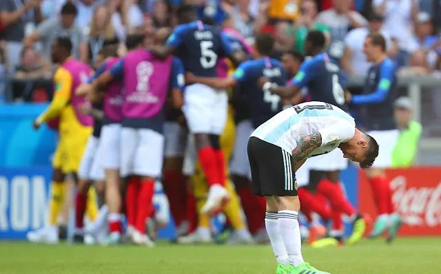
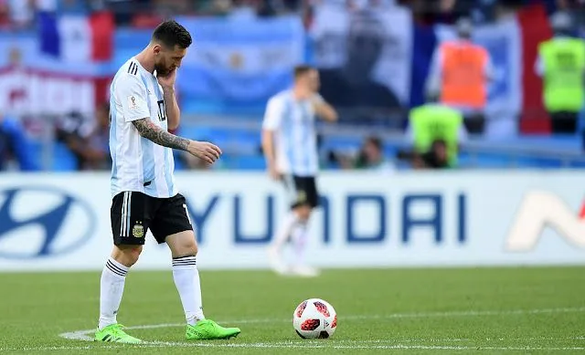
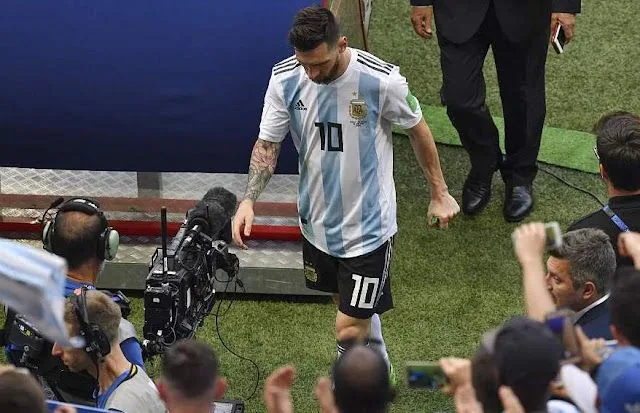

一场酣畅淋漓的大比分揭幕了本届世界杯的16强大战，同时也终结了阿根廷的问鼎之路，更重要的是，扼杀了梅西可能是这辈子最后一次冲击国家荣誉的机会。这个夜晚，是高卢雄鸡以姆巴佩为首的更替循环的开始，更是潘帕斯雄鹰整个足球时代的落幕。

先略微评说一下比赛：毫无疑问，这场比赛称得上本届世界杯目前为止最精彩的一场比赛，双方11分钟的进球就为这场大开大阖的对攻定了基调。桑保利对法国的研究显然不如德尚对自己的研究来的深入，起码的核心球员压制就没有做到，姆巴佩虽然身体素质不错，但如果能够拨出一两个人重点盯防，想必他不会像今天这么如鱼得水。年轻人拼劲和身体可以，可毕竟大赛经验不足，桑保利显然没有将自己的优势充分发挥出来；德尚在下半场丢球后及时作出调整，他看出来阿根廷打法单一，索性放弃边路，重点攻击中路，反而得到了不错的效果。另外年轻的法国队在贯彻德尚战略意图时也是相当到位。

决赛前的阿根廷向来有不顺利的传统，2014年的阿根廷一样磕磕绊绊的走到了决赛，四年之后小组赛差点被淘汰的他们可能觉得这正是走向决赛的征兆，可是运气之神不会一而再再而三的降临在这个没落的足球贵族身上。一向喜欢攻击的阿根廷在中场缺了巫师贝隆之后，发现整个前后场的衔接怎么都不顺畅，独独依靠梅西做所有的工作这对梅西本身就是一种不公平，在前面小组赛和16强、8强尚可掩盖这种残缺，但到了决赛终于梅西独木难支。可以说，2014年应该是阿根廷往后十年的最巅峰时刻了，因为这个时代的阿根廷注定是失败的时代。

今晚的比赛结束后，球赛解说员嘉远说到：“梅西无奈的不是这场比赛，梅西无奈的是整个阿根廷足球的这个时代。”

熟悉阿根廷的都知道，这是一个从不注重战线均衡的球队，2010年的阿根廷国家队，挟迭戈·米利托的国米三冠王之余威，带上伊瓜因、梅西、特维斯、阿圭罗共五名顶级前锋，马拉多纳妄图以“最好的防守就是进攻”这一理念将阿根廷送进决赛圈，可是他不知道中场的贝隆已经老去，马斯切拉诺在巴萨定位尚不明确，帕斯托雷尚未成长，罗德里格斯和古铁雷斯难堪大用；后防线只有老将萨穆埃尔称得上真正的“岩石”，奥塔门迪、海因策、布尔迪索在面对高水平对手时无法做到严防死守，这样一只头重脚轻的球队，还能指望它走的了多远吗？   
不知道什么时候开始，阿根廷不产中场和后卫了，前锋线人才辈出，这对于俱乐部比赛和洲际比赛确实相当有力，整个场面就全靠锋线大将就可撑起；可在世界杯赛场就不同了，2006年没有正印前锋的意大利正是靠着铁桶一般的防守斩齐达内的法国于马下。在万军之前，乔峰也只能束手无策。

足球，永远是一个均衡的游戏。

梅西，是另一个时代的牺牲品，在2009——2015年共夺5座金球奖，其中2009——2012更是史无前例的蝉联四次金球奖。7座西班牙超级杯、5座西班牙国王杯、8座西甲冠军奖杯、3座欧洲超级杯、3座世俱杯、4座欧冠……在俱乐部层面，他已经可以无欲无求了，但不知道谁在他巅峰的时候说了一句：“真正伟大的球员是帮助国家队夺得世界杯。”从此，他的目标开始有了变化，2010——2014——2018每一次世界杯他的对内地位都会得到一次提升，但那个好像近在咫尺的大力神杯却怎么也触碰不到，为什么在欧洲可以无风唤雨的他在世界杯上想前进一步都好像变得那么奢望与无稽？也许这场比赛之后，梅西会找到答案，因为在阿根廷没有托起梅西起舞的体系。

十年前，2008——2009赛季，尚显青涩与稚嫩的梅西第一次捧起金球奖，全世界都为他的足球才华与努力所惊叹，恩施瓜迪奥拉也为梅西量身定制了一套称之为“TiKi-TaKa”的战术体系，以亚亚图雷、凯塔构成钢铁后腰、哈维、伊涅斯塔组成传控中场；普约尔——阿比达尔镇守后防、阿尔维斯边路突破；解决了后防和中场的问题后，所有的炮弹和机会统统输送给了中路的梅西，在这样强力的支持下梅西自然成为诺坎普宠儿。这个理念也被2014年西班牙主教练博斯克带入了世界杯赛场，可是博斯克忘了这套战术完全就是为了给梅西量身定制的，世界杯的西班牙没有梅西，自然2014年世界杯西班牙小组赛失败了（球员换代、战术体系被破解、求生欲望下降也是不可忽视的因素）。

回到阿根廷也是一样，阿根廷没有巴萨的战术体系，没有梅西熟悉的传控战术思想，在球风细腻的伊比利亚半岛转到奔放的潘帕斯高原，梅西迷失了自我、迷失了方向。他从巴萨带到祖国的只有自己那一颗未曾泯灭的求胜心，除此之外，他和他的阿根廷一无所有。

2018年的梅西已经31岁，在阴冷的喀山竞技场他已经感受不到年少时足球带给他的轻松和快乐，在他的双肩他体会到的是国家荣誉和自我实现的沉沉重担；他感受到的是岁月无情地在他脸上刻下的道道印痕；他熟稔的是世界杯上残酷无情的淘汰和厮杀；他更焦急的是英雄迟暮伴随而来的无奈和伤感。在今晚的赛场，他在前场看着姆巴佩带球突破和长途奔袭的背影，想到的是十年前那个意气风发的阿根廷少年，他眼中的10号球衣除了颜色不同以外，背负这个荣誉号码的不正是十年前的自己吗？只是万物犹在，物似人非，今天的梅西只能目送远去的姆巴佩和欢庆的法国队，只能在记忆中回忆起10号球衣的那个年轻人依然犀利和霸气。怎奈花有重开日，人无再少年，世间万物总有接替循环的一天，属于一个人的时代总会逝去，但往往接替自己手中权杖的后继者献上的不是尊敬与仰望，更多的可能是无情与冷漠的一剑封喉。

不管怎样，属于阿根廷的时代已经过去，令梅西无奈的阿根廷足球的时代已经消逝；高卢雄鸡百花齐放的时代已经到来，世间的焦点在姆巴佩的成长下定位从南美转移到欧罗巴大地，希望新生代可以带给我们一样的精彩和足够的希望。

感谢梅西十年来的奉献和拼搏，希望他在未来的日子里一样精彩和辉煌。
